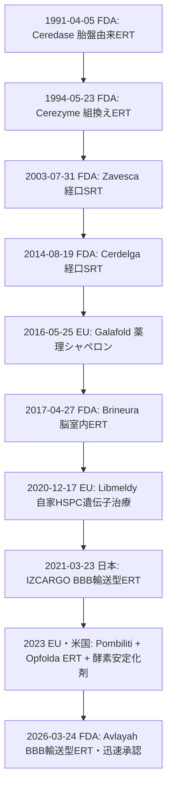

  作成日：<time datetime="{{ page.date | date_to_xmlschema }}">{{ page.date | date: "%Y年%-m月%-d日" }}</time>
  ／ 最終更新日：<time datetime="{{ page.last_modified_at | date_to_xmlschema }}">{{ page.last_modified_at | date: "%Y年%-m月%-d日" }}</time>

> **対象オルガネラ**：Lysosome / **主なモダリティ**：ERT、SRT、薬理シャペロン、遺伝子治療 / **主な適応**：リソソーム病（LSD）

## 概要

リソソームは、細胞内で不要物や高分子を分解・リサイクルするオルガネラです。リソソームには多数の加水分解酵素（lysosomal hydrolases）が存在し、これらの酵素遺伝子の変異や、リソソーム機能維持に関わるタンパク質の欠損は、基質（substrate）の蓄積を介して重篤な病態（lysosome-related disorders）を引き起こし得ます。
本記事では、リソソーム関連疾患に対する承認薬を、作用形式（ERT / SRT / 薬理シャペロン / 遺伝子治療）で整理し、表に記した地域の承認年の時系列で俯瞰できるようにまとめます。

ERT（Enzyme Replacement Therapy；酵素補充療法）は、欠損・機能低下したリソソーム酵素を外因性に補充する治療で、末梢臓器病変に対して標準治療として確立してきました。一方で、通常の酵素製剤は静脈内投与後に血液脳関門（BBB；blood–brain barrier）を通過しにくく、中枢神経症状（CNS manifestations）への作用が制限されます。pabinafusp alfaのように、受容体を利用するBBB輸送機能を酵素に組み込む設計は、この送達上の制約に対応するアプローチです。[^27][^jcr-iz-label]

そこで近年は、基質の産生側を抑えるSRT、変異酵素のフォールディング／トラフィッキングを補助する薬理シャペロン、投与経路を工夫して中枢神経系へ直接送達するアプローチ（脳室内投与など）、さらに遺伝子導入により長期的な酵素活性の回復を狙う遺伝子治療へと、治療モダリティが拡張してきました。

## 承認済みリソソーム標的薬（主要）

日米欧の主な承認薬を選択して掲載しています。各行に記した地域での承認年順に並べており、全承認薬・全適応を網羅する一覧ではありません。**「承認年」は世界初承認年に統一したものではなく、同じ一般名でも適応・剤形・地域で承認時期が異なります。** 適応の記載は要約であり、詳細は各地域の承認文書によります。会社名は開発・販売に関わる企業を示し、承認当時の社名を含みます。

| 疾患/適応 | 一般名［販売名］ | 作用形式 | 会社 | 承認年（記載地域） | 投与 | メモ |
|---|---|---|---|---|---|---|
| Gaucher病1型・3型の非中枢神経症状（米国） | imiglucerase［Cerezyme］ | ERT | Sanofi Genzyme | 1994（米）[^1] | 点滴 | 組換えERT。3型への米国適応拡大は2026年[^cerezyme2026] |
| Cystinosis | **cysteamine**［Cystagon/Procysbi］ | **シスチン低下** | Mylan/Horizon | 1994（米：IR）[^2] | 経口 | 遅延放出（DR）は2013（米）[^3] |
| Fabry病（EU） | agalsidase alfa［Replagal］ | ERT | Takeda | 2001（EU）[^4] | 点滴 | EU承認品目として掲載 |
| Fabry病 | agalsidase beta［Fabrazyme］ | ERT | Sanofi Genzyme | 2003（米）[^5] | 点滴 | 主要ERT |
| MPS I | laronidase［Aldurazyme］ | ERT | BioMarin/Genzyme | 2003（米/EU）[^6] | 点滴 | IDUAを補充 |
| Gaucher病1型（ERT不適） | miglustat［Zavesca］ | **SRT** | Actelion→Janssen | 2003（米）[^7] | 経口 | 代替療法（EUではNPCにも適応） |
| MPS VI | galsulfase［Naglazyme］ | ERT | BioMarin | 2005（米）[^8] | 点滴 | ARSBを補充 |
| Pompe病 | alglucosidase alfa［Myozyme/Lumizyme］ | ERT | Sanofi | 2006（EU/米）[^9] | 点滴 | Myozymeの承認年を記載 |
| MPS II（ハンター） | idursulfase［Elaprase］ | ERT | Takeda | 2006（米）[^10] | 点滴 | 週1回投与 |
| NPC（Niemann–Pick C） | **miglustat**［Zavesca］ | **SRT** | Advanz等 | 2009（EU）[^11] | 経口 | 進行性神経症状にEU適応 |
| Gaucher病1型 | velaglucerase alfa［VPRIV］ | ERT | Shire→Takeda | 2010（米）[^12] | 点滴 | 別の酵素製剤 |
| Gaucher病1型 | taliglucerase alfa［Elelyso］ | ERT | Protalix/Pfizer | 2012（米）[^13] | 点滴 | 植物細胞由来 |
| Gaucher病1型 | eliglustat［Cerdelga］ | **SRT** | Sanofi Genzyme | 2014（米）[^14] | 経口 | GCS阻害。CYP2D6表現型で適格性・用量を規定 |
| MPS IVA（モルキオA） | elosulfase alfa［Vimizim］ | ERT | BioMarin | 2014（米）[^15] | 点滴 | GALNSを補充 |
| LAL欠損症 | sebelipase alfa［Kanuma］ | ERT | Alexion | 2015（米/EU）[^16] | 点滴 | LALを補充 |
| Fabry病 | **migalastat**［Galafold］ | **薬理シャペロン** | Amicus | 2016（EU）[^17] | 経口 | 変異“amenable”例に限定 |
| MPS VII（Sly） | vestronidase alfa［Mepsevii］ | ERT | Ultragenyx | 2017（米）[^18] | 点滴 | 超希少疾患 |
| CLN2（バッテン病） | cerliponase alfa［Brineura］ | **脳室内ERT** | BioMarin | 2017（米/EU）[^19] | 脳室内 | 中枢投与 |
| α-マンノシドーシス | velmanase alfa［Lamzede］ | ERT | Chiesi | 2018（EU）[^20] | 点滴 | 非中枢神経症状が対象。2023年に米国承認[^21] |
| Fabry病 | agalsidase beta biosimilar 1［アガルシダーゼ ベータBS「JCR」］ | ERT（biosimilar） | JCR Pharmaceuticals | 2018-09-21（日本）[^jcr-ag-if] | 点滴 | Fabrazymeのbiosimilar。開発コードJR-051[^jcr-ag-label] |
| 異染性白質ジストロフィー(MLD) | **atidarsagene autotemcel**［Libmeldy / Lenmeldy］ | **遺伝子治療**（自家HSC） | Orchard | 2020（EU）[^22] | 移植 | 2024年に米国でもLenmeldyとして承認[^lenmeldy] |
| MPS II（Hunter syndrome） | **pabinafusp alfa［IZCARGO／イズカーゴ］** | **BBB輸送型ERT（J-Brain Cargo）** | JCR Pharmaceuticals | **2021-03-23（日本）**[^jcr-iz-if] | 点滴 | 開発コードJR-141。抗TfR抗体–IDS融合タンパク質。週1回投与[^jcr-iz-label] |
| Pompe病（遅発型） | avalglucosidase alfa［Nexviazyme］ | ERT | Sanofi | 2021（米）[^23] | 点滴 | EUのNexviadymeは2022年承認[^nexviadyme-eu] |
| ASMD（Niemann–Pick A/B） | olipudase alfa［Xenpozyme］ | ERT | Sanofi | 2022（JP→EU/米）[^24] | 点滴 | 非中枢症状に適応 |
| Fabry病 | pegunigalsidase alfa［Elfabrio］ | ERT | Protalix/Chiesi | 2023（米/EU）[^25] | 点滴 | PEG修飾ERT |
| Pompe病（成人） | cipaglucosidase alfa＋miglustat［Pombiliti+Opfolda］ | ERT＋酵素安定化剤 | Amicus | 2023（米/EU）[^26] | 点滴＋経口 | miglustatは補充酵素を安定化 |
| MPS IIの神経症状（米国） | tividenofusp alfa-eknm［Avlayah］ | BBB輸送型ERT | Denali Therapeutics | 2026-03-24（米）[^avlayah-approval] | 点滴 | 体重5kg以上の小児で、高度な神経障害に至る前に開始。CSF中HS低下を根拠とする迅速承認[^avlayah-label] |

表中の略語：MPS＝mucopolysaccharidosis、LAL＝lysosomal acid lipase、ASMD＝acid sphingomyelinase deficiency、MLD＝metachromatic leukodystrophy、HSC＝hematopoietic stem cell、LOPD＝late-onset Pompe disease、PEG＝polyethylene glycol。IR／DRは、それぞれimmediate release／delayed releaseを示します。

[^1]: FDA Orphan Drug Designations and Approvals: Cerezyme (imiglucerase) — Marketing Approval Date 05/23/1994.  [FDA Access Data](https://www.accessdata.fda.gov/scripts/opdlisting/oopd/detailedIndex.cfm?cfgridkey=62491)
[^2]: FDA Orphan Drug Designations and Approvals: Cystagon (cysteamine) — Marketing Approval Date 08/15/1994.  [FDA Access Data](https://www.accessdata.fda.gov/scripts/opdlisting/oopd/detailedIndex.cfm?cfgridkey=55690)
[^3]: FDA. Procysbi（cysteamine bitartrate）初回承認文書、2013年4月30日。[承認文書](https://www.accessdata.fda.gov/drugsatfda_docs/nda/2013/203389Orig1s000Approv.pdf)。
[^4]: EMA EPAR: Replagal — EU marketing authorisation granted 3 Aug 2001.  [European Medicines Agency (EMA)](https://www.ema.europa.eu/en/medicines/human/EPAR/replagal)
[^5]: FDA Orphan Drug Designations and Approvals: Fabrazyme (agalsidase beta) — Marketing Approval Date 04/24/2003.  [FDA Access Data](https://www.accessdata.fda.gov/scripts/opdlisting/oopd/detailedIndex.cfm?cfgridkey=15286)
[^6]: FDA Orphan Drug Designations and Approvals: Aldurazyme (laronidase) — Marketing Approval Date 04/30/2003.  [FDA Access Data](https://www.accessdata.fda.gov/scripts/opdlisting/oopd/detailedIndex.cfm?cfgridkey=106097)
[^7]: FDA Orphan Drug Designations and Approvals: Zavesca (miglustat) — Marketing Approval Date 07/31/2003.  [FDA Access Data](https://www.accessdata.fda.gov/scripts/opdlisting/oopd/detailedIndex.cfm?cfgridkey=112598)
[^8]: FDA. Naglazyme（galsulfase）承認文書、2005年5月31日。[承認文書](https://www.accessdata.fda.gov/drugsatfda_docs/nda/2005/125117s000_Naglazyne_approv.pdf)。
[^9]: EMA. Myozyme（alglucosidase alfa）EPAR。EU承認日2006年3月29日。[EPAR](https://www.ema.europa.eu/en/medicines/human/EPAR/myozyme)。MyozymeとLumizymeの製品別承認年は同一ではない。
[^10]: FDA Purple Book. Elaprase（idursulfase）、BLA 125151。米国初回承認日2006年7月24日。[承認情報](https://purplebooksearch.fda.gov/index.cfm?blaNo=125151&event=productdetails)。
[^11]: EMA. Zavesca（miglustat）EPAR。NPCの進行性神経症状に対する適応情報。[EPAR](https://www.ema.europa.eu/en/medicines/human/EPAR/zavesca)。NPCへの適応追加は2009年（Gaucher病に対するEU初回承認は2002年）。
[^12]: Shire. FDA approval of VPRIV（velaglucerase alfa）, 2010年2月26日。[企業公表資料（SEC提出書類）](https://www.sec.gov/Archives/edgar/data/936402/000095010310000594/dp16692_ex9901.htm)。
[^13]: FDA. Elelyso（taliglucerase alfa）承認書、2012年5月1日。[承認書](https://www.accessdata.fda.gov/drugsatfda_docs/appletter/2012/022458s000ltr.pdf)。
[^14]: FDA Orphan Drug Designations and Approvals: Cerdelga (eliglustat) — Marketing Approval Date (FDA OPD listing).  [FDA Access Data](https://www.accessdata.fda.gov/scripts/opdlisting/oopd/detailedIndex.cfm?cfgridkey=265408)
[^15]: FDA. Vimizim（elosulfase alfa）Orphan Drug Designations and Approvals。承認日2014年2月14日。[承認情報](https://www.accessdata.fda.gov/scripts/opdlisting/oopd/detailedIndex.cfm?cfgridkey=280809)。
[^16]: EMA. Kanuma（sebelipase alfa）EPAR。[EU承認情報](https://www.ema.europa.eu/en/medicines/human/EPAR/kanuma)。FDA. 2015年12月8日承認書。[米国承認書](https://www.accessdata.fda.gov/drugsatfda_docs/appletter/2015/125561Orig1s000ltr.pdf)。
[^17]: EMA. Galafold（migalastat）EPAR。EU承認日2016年5月25日。[EPAR](https://www.ema.europa.eu/en/medicines/human/EPAR/galafold)。
[^18]: Ultragenyx press release: FDA approval of Mepsevii (vestronidase alfa) on Nov 15, 2017.  [Ultragenyx](https://ir.ultragenyx.com/news-releases/news-release-details/ultragenyx-announces-fda-approval-mepseviitm-vestronidase-alfa)
[^19]: FDA approval document for Brineura (cerliponase alfa), dated Apr 27, 2017.  [FDA Access Data](https://www.accessdata.fda.gov/drugsatfda_docs/nda/2017/761052Orig1s000Approv.pdf)
[^20]: EMA. Lamzede（velmanase alfa）EPAR。EU承認日2018年3月23日。[EPAR](https://www.ema.europa.eu/en/medicines/human/EPAR/lamzede)。
[^21]: FDA Orphan Drug Designations and Approvals: Lamzede (velmanase alfa) — US marketing approval (FDA OPD listing).  [FDA Access Data](https://www.accessdata.fda.gov/scripts/opdlisting/oopd/detailedIndex.cfm?cfgridkey=212005)
[^22]: EMA EPAR: Libmeldy — EU marketing authorisation valid throughout EU on 17 Dec 2020.  [European Medicines Agency (EMA)](https://www.ema.europa.eu/en/medicines/human/EPAR/libmeldy)
[^23]: FDA Purple Book. Nexviazyme（avalglucosidase alfa-ngpt）、BLA 761194。米国初回承認日2021年8月6日。[承認情報](https://purplebooksearch.fda.gov/index.cfm?blaNo=761194&event=productdetails)。
[^24]: FDA Orphan Drug Designations and Approvals: Xenpozyme (olipudase alfa-rpcp) — Marketing Approval Date 08/31/2022; Japan first approval mentioned by Sanofi (Mar 2022).  [FDA Access Data](https://www.accessdata.fda.gov/scripts/opdlisting/oopd/detailedIndex.cfm?cfgridkey=132900)
[^25]: FDA approval letter: Elfabrio (pegunigalsidase alfa-iwxj) — approved effective May 9, 2023.  [FDA Access Data](https://www.accessdata.fda.gov/drugsatfda_docs/appletter/2023/761161Orig1s000ltr.pdf)
[^26]: EMA. Pombiliti（cipaglucosidase alfa）EPAR、2023年3月20日承認。[EPAR](https://www.ema.europa.eu/en/medicines/human/EPAR/pombiliti)。米国でのPombiliti＋Opfoldaの併用適応は2023年承認。[FDA Pombilitiラベル](https://www.accessdata.fda.gov/drugsatfda_docs/label/2023/761204s000lbl.pdf)、[FDA Opfoldaラベル](https://www.accessdata.fda.gov/drugsatfda_docs/label/2023/215211s000lbl.pdf)。

## 対象疾患について

上記のリソソーム標的薬の対象疾患は、リソソームの機能破綻を背景にします。内訳としては、リソソーム加水分解酵素（lysosomal hydrolase）の欠損に起因するLysosomal Storage Diseases（LSD）が中心ですが、酵素欠損ではない疾患も一部含まれます。

### リソソーム加水分解酵素欠損による典型的なLSD（Lysosomal Storage Diseases）

- Gaucher病（GBA1 / β-glucocerebrosidase）
- Fabry病（GLA / α-galactosidase A）
- Pompe病（GAA / acid α-glucosidase）
- MPS I/II/IVA/VI/VII（IDUA / IDS / GALNS / ARSB / GUSB）
- LAL欠損症（LAL-D）（LIPA / lysosomal acid lipase）
- CLN2（TPP1 / tripeptidyl peptidase 1）
- ASMD（Niemann–Pick A/B）（SMPD1 / acid sphingomyelinase）
- α-マンノシドーシス（MAN2B1 / lysosomal α-mannosidase）
- MLD（ARSA / arylsulfatase A）

### （表内の例外）加水分解酵素欠損ではない lysosome-related disorders

- NPC（Niemann–Pick C）：主にNPC1/NPC2（脂質輸送・トラフィッキング異常）

- Cystinosis：CTNS（cystinosin：リソソーム膜輸送体）欠損

## 治療アプローチの全体像

リソソーム標的薬は、治療が介入する段階によって、主に以下の4系統に整理できます。各節では、共通する仕組みと課題をまとめた後、薬剤ごとの作用機序と臨床成績を紹介します。

| 治療アプローチ | 介入する対象 | 代表的な承認薬 |
|---|---|---|
| ERT（酵素補充療法） | 欠損・機能低下した酵素を補充 | imiglucerase、pabinafusp alfaなど[^27][^29] |
| SRT（基質生成抑制療法） | 蓄積する基質の合成を抑制 | miglustat、eliglustat[^srt-zavesca-label][^srt-cerdelga-eu] |
| 薬理シャペロン | 変異酵素の構造を安定化し、輸送を補助 | migalastat[^chap-pmda] |
| 遺伝子治療 | 遺伝子を導入し、欠損タンパク質の持続的な産生を目指す | atidarsagene autotemcel[^gene-ema] |

## 1. ERT（酵素補充療法）

### 概論：仕組みと課題

<strong>Enzyme Replacement Therapy（ERT）</strong>：欠損または機能低下したリソソーム加水分解酵素を、<strong>組換えタンパク質（recombinant enzyme）として外因性に補充</strong>する治療です。多くは<strong>定期的な点滴投与（IV infusion）</strong>を行います。[^27]

<strong>細胞内取り込みとリソソーム送達</strong>：ERT製剤は、末梢組織で <strong>受容体介在性エンドサイトーシス（receptor-mediated endocytosis）</strong>により細胞内へ取り込まれ、エンドソーム—リソソーム経路で標的区画へ送達されます。一般に <strong>mannose-6-phosphate receptor（M6PR）経路</strong>が基盤概念として重要であり、糖鎖を介した受容体結合が細胞内取り込みに関わります。[^28] 一方、<strong>Gaucher病のβ-glucocerebrosidase（imiglucerase など）では、標的細胞であるマクロファージのendocytic carbohydrate receptor（mannose receptor）に認識される “mannose-terminated” 糖鎖が実装上の設計勘所</strong>として明示されています。[^29]

<strong>限界</strong>  

- <strong>BBB（blood–brain barrier；血液脳関門）/CNS（central nervous system；中枢神経）移行の制約</strong>：
  通常の酵素製剤による全身投与ERTはBBBを通過しにくく、<strong>中枢症状（CNS manifestations）には効果が限定的</strong>になりやすい。[^27]  

- <strong>免疫原性と投与負担</strong>：
  定期的な点滴投与に伴う <strong>infusion-associated reactions（点滴に伴う反応）</strong>、過敏反応、抗薬物抗体（anti-drug antibodies）などが課題です。[^30][^jcr-iz-label]

### 承認薬の各論

#### cerliponase alfa / Brineura

<strong>脳室内投与による送達</strong>：<strong>Brineura（cerliponase alfa）</strong>は、CLN2（TPP1欠損）に対して <strong>脳室内投与（intraventricular infusion）</strong>を採用し、CNSへ直接投与する設計がラベルに示されています。[^30]

#### pabinafusp alfa / IZCARGO（JR-141）

<strong>承認上の位置付け</strong>：pabinafusp alfaは、ヒト化抗ヒトtransferrin receptor 1（TfR）抗体とhuman iduronate-2-sulfatase（IDS）を融合した組換えタンパク質です。日本では2021年3月23日にMPS IIを効能・効果として承認され、同年5月19日に発売されました。電子添文には、中枢神経症状の改善または進行抑制が必要と考えられる患者で投与を検討する旨が記されています。[^jcr-iz-label][^jcr-iz-if]

<strong>分子設計と非臨床での検証</strong>：J-Brain Cargoは、TfRを利用するBBB輸送技術です。2018年の原著では、human TfR knock-in mice、MPS II model mice、monkeysで融合タンパク質の脳内分布を調べ、疾患モデルマウスでは脳内glycosaminoglycans（GAG）の減少を報告しました。これは非臨床のproof of conceptにあたり、ヒトでの神経認知機能への効果は臨床データから別途評価する必要があります。[^jcr-sonoda2018]

<strong>BBB通過からリソソームまで</strong>：電子添文の作用機序には、以下の過程が示されています。[^jcr-iz-label]

1. 抗体部分が脳毛細血管内皮のTfRに結合し、<strong>receptor-mediated transcytosis（受容体介在性トランスサイトーシス）</strong>を介してBBBを通過する。
2. 末梢組織および脳実質の細胞では、<strong>cation-independent mannose-6-phosphate receptor（CI-M6PR）およびTfR</strong>を介して取り込まれ、リソソームへ運ばれる。
3. 薬剤の酵素部分（IDS）が、リソソーム内に蓄積したGAGを分解する。

この設計では、BBB内皮を越える輸送と、標的細胞内でのリソソーム送達の両方を考える必要があります。[^jcr-iz-label][^jcr-sonoda2018]

<strong>国内第II/III相試験で示されたこと</strong>：Okuyamaらの試験は、MPS IIの28例を対象とした<strong>単群・非盲検の52週間試験</strong>でした。25例はidursulfaseの既治療例です。主要評価項目はcerebrospinal fluid（CSF；脳脊髄液）中heparan sulfate（HS）濃度で、解析対象27例の平均値（±標準偏差）は、投与開始前の<strong>5,856 ± 2,614 ng/mLから52週時点の2,124 ± 882.6 ng/mL</strong>へ低下しました。[^jcr-okuyama2021]

<strong>神経発達への効果の限界</strong>：

- 脳脊髄液（CSF）中heparan sulfate（HS）の低下は薬力学的変化を支持しますが、PMDAは、HSの変化と発達年齢の変化との間に明確な関係が示されていないと評価しました。承認時点のデータから、中枢神経症状の明確な改善を確認するには限界がありました。[^jcr-iz-review]
- 論文ではKyoto Scale of Psychological Development（KSPD；新版K式発達検査）による維持・改善が報告されました。ただし、同時対照群がなく、年齢、病型、開始時の発達段階、自然経過のplateauが解釈に影響します。著者らも、52週間では神経発達への確定的な結論を得るには短いとしています。[^jcr-okuyama2021]
- PMDAは希少性や長期評価の必要性も踏まえて一定の有効性を期待できると判断し、全投与症例を対象とした製造販売後臨床試験または使用成績調査、定期的な成績提出などを承認条件としました。[^jcr-iz-review][^jcr-mhlw2026]

<strong>安全性と長期データ</strong>：国内試験ではinfusion-associated reactions（点滴に伴う反応）と抗薬物抗体の産生が報告され、電子添文では重度の点滴関連反応やanaphylaxis（アナフィラキシー）への注意が示されています。2026年公表の27例・260週間のデータを用いた事後解析では、点滴時間の短縮と有害事象増加との関連は認められず、HS等の生化学的指標や肝脾容積にも点滴速度変更の影響は認められませんでした。[^jcr-okuyama2021][^jcr-iz-label][^jcr-nakamura2026]

<strong>海外開発・承認との区別</strong>：2026年10月2日の企業発表では、idursulfaseを実薬対照とする国際第III相<strong>STARLIGHT（JR-141-GS31、NCT04573023）</strong>が継続中で、欧米等での承認取得を目指すとされています。試験は無作為化・評価者盲検であり、非対照の国内承認時試験とは設計が異なります。日本での承認に加え、企業は2026年7月のUAE承認、同年10月のKuwaitでの条件付き承認を公表しています。[^jcr-starlight][^jcr-license2026][^jcr-kuwait2026]

#### tividenofusp alfa / Avlayah

BBB輸送型ERTの別の例として、IDSと、TfR結合能を持つ改変型の抗体Fc領域（定常領域の一部）を融合したtividenofusp alfaがあります。2026年3月24日に米国でMPS IIの神経症状に対して承認されました。対象は体重5kg以上の小児で、高度な神経障害に至る前に治療を開始する患者です。CSF中HSの低下を根拠とする迅速承認であり、臨床的利益を確認する試験が求められています。[^avlayah-label][^avlayah-approval][^avlayah-trial]

---

## 2. SRT（基質生成抑制療法）

### 概論：仕組みと課題

<strong>Substrate Reduction Therapy（SRT）</strong>：蓄積する基質の<strong>産生を抑え、リソソームに流入する量を減らす</strong>治療です。代表的な標的は<strong>glucosylceramide synthase（GCS；glucosylceramide合成酵素）</strong>で、glucosylceramideを起点とするglycosphingolipids（GSL；スフィンゴ糖脂質）の合成を抑制します。欠損酵素を補充するERTと異なり、基質の供給側に介入する経口小分子薬として開発されました。[^srt-zavesca-label][^srt-cerdelga-eu]

### 承認薬の各論

#### miglustat / Zavesca

<strong>作用機序と位置付け</strong>：miglustatはiminosugar（イミノ糖）に分類されるGCS阻害薬です。米国では2003年に、ERTが治療選択肢にならない成人の軽症～中等症Gaucher病1型に承認されました。承認につながった28例の非盲検・非対照試験では、12か月後に肝容積が平均12%、脾容積が19%減少し、酵素を補充せずに基質合成を抑える治療の臨床的な可能性を示しました。[^srt-zavesca-label][^srt-miglustat-gd]

<strong>NPCの神経症状への展開</strong>：miglustatはBBBを通過し、EUではNiemann–Pick disease type C（NPC）の進行性神経症状にも適応があります。NPCはNPC1／NPC2の異常による細胞内脂質輸送障害であり、酵素欠損型のLSD以外にもSRTが展開された例です。12歳以上29例を対象とした12か月の無作為化試験では、miglustat群20例と標準治療単独群9例を比較しました。眼球運動や嚥下機能などの指標で改善・維持が報告されました。ただし、主要評価項目の眼球運動で統計的な差が認められたのは、併用薬であるbenzodiazepine系薬剤を使用していない患者を対象とした解析でした。[^srt-zavesca-eu][^srt-miglustat-npc]

<strong>安全性</strong>：下痢、体重減少、振戦が主な課題で、末梢神経障害にも注意が必要とされています。[^srt-zavesca-label][^41]

#### eliglustat / Cerdelga

<strong>作用機序と進展</strong>：eliglustatはGCSを選択的に阻害する経口薬です。2014年に米国で承認され、治療導入時の効果と、ERTで安定している患者からの切替えを、それぞれ無作為化試験で検証しました。EUでは、ERTで病状が安定した6歳以上・体重15 kg以上の小児にも適応があります。[^32][^srt-cerdelga-eu]

<strong>ENGAGE試験：治療導入時の効果</strong>：未治療、または一定期間治療を受けていなかった成人40例を対象とした9か月の二重盲検・プラセボ対照第III相試験では、脾容積がeliglustat群で<strong>27.8%減少</strong>し、プラセボ群では<strong>2.3%増加</strong>しました。hemoglobin、血小板数、肝容積もプラセボ群より改善し、経口SRTによる血液学的・内臓病変の改善が示されました。[^srt-engage]

<strong>ENCORE試験：ERT後の安定性維持</strong>：ERTで安定していた成人をeliglustatへの切替えとimiglucerase継続に無作為化した52週間の非盲検試験です。主要評価項目はhemoglobin、血小板数、肝脾容積を組み合わせた病状安定性で、主要解析ではeliglustat群の<strong>85%（84/99例）</strong>、imiglucerase群の<strong>94%（44/47例）</strong>が基準を満たし、事前に設定した範囲で非劣性が確認されました。経口薬への切替え後も安定性を維持できる患者がいることを示した試験です。[^srt-encore]

<strong>近年の長期データ</strong>：International Collaborative Gaucher Group（ICGG）Gaucher Registryは、各国の医療機関がGaucher病患者の症状、検査値、治療内容などを継続的に記録する、国際的な患者登録データベースです。2024年には、この登録データを用いて、eliglustatで治療した成人Gaucher病1型469例の経過を解析した研究が公表されました。ERTからeliglustatへ切り替えた患者では、ヘモグロビン濃度、血小板数、肝脾容積などの指標が長期にわたって安定しており、一部の指標は最長10年間追跡されました。[^srt-registry2024]

<strong>適用範囲と安全性</strong>：eliglustatは主として末梢病変を対象とし、中枢神経症状への効果を検証した薬ではありません。また、CYP2D6代謝型によって薬物曝露が変わり、CYP2D6／CYP3A阻害薬との相互作用による濃度上昇や心電図変化が課題です。[^srt-cerdelga-eu][^33]

### 開発中の候補（未承認）

#### venglustat

venglustatは、BBB通過性を持つよう開発されたGCS阻害薬です。2026年にSanofiは、ERTで末梢病変が安定した12歳以上のGaucher病3型43例を対象とする無作為化・二重盲検・実薬対照第III相<strong>LEAP2MONO（NCT05222906）</strong>で、52週の運動失調・認知機能の統合評価がERT群より改善したと公表しました（global test、p＝0.0179）。評価にはScale for Assessment and Rating of Ataxia（SARA；運動失調評価尺度）の修正版と、Repeatable Battery for the Assessment of Neuropsychological Status（RBANS；神経心理学的検査）が用いられました。[^srt-veng-results]

---

## 3. 薬理シャペロン

### 概論：仕組みと課題

<strong>Pharmacological chaperone</strong>：特定の変異によって不安定になったリソソーム酵素に結合し、<strong>立体構造の安定化とリソソームへの輸送を助ける</strong>ことで、患者自身が産生する酵素の働きを引き出す治療です。代表的な承認薬は、Fabry病に対する<strong>migalastat（Galafold）</strong>です。[^chap-pmda]

### 承認薬の各論

#### migalastat / Galafold

<strong>発見と治療上の進展</strong>：1999年、Fanらはα-galactosidase A（α-Gal A）の阻害剤である1-deoxygalactonojirimycin（DGJ）が、低濃度ではFabry病患者由来細胞の変異酵素の輸送・成熟を助け、酵素活性を高めることを報告しました。酵素を阻害する分子を、酵素の構造を安定化するために利用する発想が、migalastatの開発につながりました。2016年のEU承認により、反応性のある変異を持つ患者には、点滴ERTに加えて経口の治療選択肢が加わりました。[^chap-fan1999][^chap-ema]

<strong>作用機序と対象</strong>：migalastatは、小胞体（endoplasmic reticulum；ER）で特定の変異型α-Gal Aの活性部位に選択的・可逆的に結合し、不安定な構造を安定化します。これにより酵素のリソソームへの輸送を促し、酸性環境と基質の存在下で酵素から解離した後、α-Gal Aによるglobotriaosylceramide（GL-3）の分解を可能にします。適応は、<strong>in vitro試験で薬剤への反応性が確認されたGLA遺伝子変異（amenable variant）</strong>を持つFabry病に限られます。酵素の産生が失われた場合など、すべての遺伝子変異に適用できる方法ではありません。[^chap-pmda][^chap-fda-review]

<strong>第III相試験で示されたこと</strong>：プラセボ対照・二重盲検の<strong>FACETS（67例）</strong>では、6か月で腎間質毛細血管のGL-3蓄積が50%以上減少した患者の割合はmigalastat群41%、プラセボ群28%で、<strong>主要評価項目の群間差は有意ではありませんでした</strong>。一方、検証済みの検査でamenableと判定された患者の追加解析では、migalastatによる腎組織中GL-3蓄積の減少が認められました。この結果は、患者選定に変異酵素の反応性評価を組み込む重要性を示しています。[^chap-facets]

ERT既治療の成人57例を対象とした無作為化・非盲検の<strong>ATTRACT</strong>では、migalastatへの切替とERT継続を18か月間比較しました。反応性変異を持つ解析対象例の推定糸球体ろ過量（eGFR）の年間変化は、それぞれ<strong>−0.40と−1.03 mL/min/1.73 m²</strong>で、腎機能に対する効果は同程度と評価されました。migalastat群では左室重量係数（LVMI）も投与開始前から平均6.6 g/m²減少しました。[^chap-attract][^chap-pmda]

<strong>近年の長期・小児データ</strong>：2025年公表の<strong>ASPIREとその継続試験</strong>では、12歳以上18歳未満、体重45 kg以上の21例を最長48か月追跡しました。腎機能と心臓の評価指標は正常範囲内で維持され、Fabry病の生化学的指標である血漿中globotriaosylsphingosine（lyso-Gb3）も安定していました。新たな予期しない安全性所見は認められませんでしたが、この研究は単群・非盲検であり、治療しなかった場合との差を直接比較したものではありません。[^chap-aspire2025]

<strong>適用上の制約と安全性</strong>：反応性変異の確認に加え、腎機能や病期の評価が必要です。日本の電子添文では成人および12歳以上の小児が対象で、重度の腎機能障害患者への投与は推奨されていません。頭痛、下痢、悪心などの副作用が記載され、2025年改訂では血管性浮腫も追記されました。[^chap-pmda]

### 関連する併用療法：ERT＋酵素安定化剤

#### cipaglucosidase alfa＋miglustat / Pombiliti＋Opfolda

<strong>安定化する対象の違い</strong>：Pompe病の<strong>cipaglucosidase alfa（Pombiliti）＋miglustat（Opfolda）</strong>は、2023年にEU・米国で承認された併用療法です。ここでmiglustatは、患者自身の変異酵素ではなく、<strong>点滴で投与するacid α-glucosidase（GAA）を血中で安定化するenzyme stabilizer（酵素安定化剤）</strong>として働きます。補充酵素が筋細胞に取り込まれる前の失活を抑え、細胞内に届いた酵素が蓄積glycogenを分解する設計です。miglustatをGaucher病やNPCで用いる際のSRTとは、役割が異なります。[^chap-opfolda][^chap-pombiliti]

<strong>PROPELと継続試験</strong>：成人のlate-onset Pompe disease（LOPD）を対象とした無作為化・二重盲検の<strong>PROPEL</strong>では125例が割り付けられ、123例が治療を受けました。52週の6分間歩行距離の平均変化は、併用群<strong>＋20.8 m</strong>、alglucosidase alfa＋プラセボ群<strong>＋7.2 m</strong>でした。群間差は13.6 m（95%信頼区間−2.8〜29.9 m）で、<strong>主要評価項目について対照療法への優越性は示されませんでした</strong>。[^chap-propel]

2024年に公表された118例の非盲検継続試験では、併用療法を継続した患者で、PROPELで得られた運動機能の改善が104週まで維持されたと報告されました。[^chap-propel-ole2024]

2026年10月のWorld Muscle Societyでは、PROPEL開始時から併用療法を継続した82例の最長5年間の成績が発表されました。企業による発表内容の報告では、運動機能の維持などが示され、新たな安全性上の懸念は認められなかったとされています。[^chap-propel-wms2026]

<strong>安全性</strong>：この併用療法では、補充酵素の安定化を図りながら定期的な点滴投与を続けます。点滴関連反応やanaphylaxis（アナフィラキシー）への注意も必要です。[^chap-pombiliti]

---

## 4. 遺伝子治療

### 概論：仕組みと課題

<strong>Gene therapy</strong>：治療に必要な遺伝子を細胞へ導入し、<strong>欠損タンパク質の持続的な産生</strong>を目指す治療です。リソソーム病では、患者から採取した造血幹・前駆細胞を体外で改変して戻す<strong>ex vivo gene therapy</strong>が承認されています。[^gene-ema]

### 承認薬の各論

#### atidarsagene autotemcel / Libmeldy・Lenmeldy

<strong>承認上の位置付け</strong>：atidarsagene autotemcel（arsa-cel）は、arylsulfatase A（ARSA）欠損によるmetachromatic leukodystrophy（MLD；異染性白質ジストロフィー）に対する細胞遺伝子治療薬です。EUでは2020年にLibmeldy、米国では2024年にLenmeldyとして承認されました。対象は発症前のlate-infantile型（後期乳児型）・early-juvenile型（早期若年型）、または発症早期のearly-juvenile型の小児であり、病期が進行したMLD全般への承認ではありません。EUでは発症早期例について、自立歩行が可能で認知機能低下が始まる前という条件が示されています。[^gene-ema][^gene-fda-approval]

<strong>遺伝子導入からリソソームまで</strong>：患者自身のCD34+ hematopoietic stem and progenitor cells（HSPCs；造血幹・前駆細胞）を採取し、lentiviral vectorを用いて機能的なARSA遺伝子を体外で導入します。Busulfanによる<strong>myeloablative conditioning（骨髄破壊的前処置）</strong>の後に細胞を投与すると、改変細胞が骨髄に生着し、その子孫がARSAを産生します。一部の細胞は中枢・末梢神経系のmacrophage系細胞として定着し、分泌したARSAが周囲の細胞に取り込まれて、リソソーム内のsulfatidesの分解に働きます。この<strong>cross-correction（細胞間での酵素補完）</strong>により、遺伝子を直接導入していない細胞にも酵素を供給する設計です。[^gene-eu-mechanism]

酵素タンパク質の定期投与に対し、arsa-celでは生着した細胞を長期的な酵素供給源とすることが技術上の特徴です。投与製剤に含まれるのは遺伝子改変した自家細胞であり、lentiviral vectorそのものを患者へ直接投与する方法とは異なります。[^gene-eu-mechanism]

<strong>承認につながった臨床成績</strong>：2022年のFumagalliらの報告では、非無作為化・非盲検の第I/II相試験と拡大アクセスで治療した早期発症MLDの29例を、未治療の自然歴31例と比較しました。ARSA活性の持続的な回復に加え、治療2年後のgross motor function measure（GMFM；粗大運動機能尺度）は自然歴群より良好で、多くの患者で運動技能の獲得または維持が報告されました。効果は、とくに発症前に投与した患者で明瞭でした。[^gene-fumagalli2022]

<strong>2025年に報告された長期追跡</strong>：その後の報告は治療39例と自然歴49例を比較し、追跡期間中央値は<strong>6.76年、最長12.19年</strong>でした。主要評価項目は、出生から重度の運動障害（移動能力と支えなしで座る能力の喪失）または死亡までの期間を指す<strong>severe motor impairment-free survival（重度運動障害のない生存）</strong>です。6歳時点の推定割合は、発症前late-infantile型の治療群で<strong>100%</strong>、未治療late-infantile型で<strong>0%</strong>でした。Early-juvenile型では、10歳時点で発症前治療群<strong>87.5%</strong>、発症早期治療群<strong>80.0%</strong>、未治療群<strong>11.2%</strong>と報告されました。[^gene-fumagalli2025]

<strong>安全性と治療時期</strong>：自家細胞を用いても、細胞採取、前処置、血球回復までの管理を伴う治療です。米国ラベルではfebrile neutropenia（発熱性好中球減少症）、感染症、肝veno-occlusive disease（肝静脈閉塞性疾患）などへの注意が示されています。Lentiviral vectorのゲノム挿入に伴う発がんリスクについても長期監視が必要とされます。[^gene-us-label][^gene-ema]

### 開発中の候補（未承認）

#### CTNS-RD-04（Cystinosis）

2026年には、リソソーム膜のcystine transporterである<strong>cystinosin</strong>の遺伝子CTNSを自家HSPCsへ導入する、第I/II相・非盲検試験の結果が報告されました。20〜46歳の6例を29〜63か月追跡し、投与24か月後の白血球中cystine濃度は全例で投与前より<strong>25〜86%低下</strong>しました。欠損酵素に加えて、リソソーム膜輸送体を標的とする細胞遺伝子治療への展開例です。一方、少数例の初期試験であり、腎機能低下や長期的な全身合併症をどの程度抑制できるかは、今後の評価が必要です。[^gene-cystinosis2026]

---

## モダリティ開発のマイルストーン

1. <strong>1991-04-05：Ceredase（alglucerase）</strong> — 胎盤由来酵素による初期ERTが、Gaucher病1型に対してFDAで承認。[^38]
2. <strong>1994-05-23：Cerezyme（imiglucerase）</strong> — 組換え酵素によるERTがFDAで承認。[^39][^29]
3. <strong>2003-07-31：Zavesca（miglustat）</strong> — ERTが選択肢にならないGaucher病1型に対し、経口SRTがFDAで承認。[^7][^31]
4. <strong>2014-08-19：Cerdelga（eliglustat）</strong> — 治療導入時とERTからの切替えを検証した経口SRTがFDAで承認。[^32][^srt-engage][^srt-encore]
5. <strong>2016-05-25：Galafold（migalastat）</strong> — 反応性のあるGLA変異を対象とする薬理シャペロンがEUで承認。[^chap-ema]
6. <strong>2017-04-27：Brineura（cerliponase alfa）</strong> — CLN2に対する脳室内ERTがFDAで承認。[^19][^30]
7. <strong>2020-12-17：Libmeldy（atidarsagene autotemcel）</strong> — 自家HSPCsを改変するex vivo遺伝子治療が早期発症MLDに対してEUで承認。米国では2024-03-18にLenmeldyとして承認。[^gene-ema][^gene-fda-approval]
8. <strong>2021-03-23：IZCARGO（pabinafusp alfa）</strong> — TfRを介したBBB輸送機能を組み込んだERTとして、日本でMPS IIに承認。[^jcr-iz-label][^jcr-iz-if]
9. <strong>2023：Pombiliti（cipaglucosidase alfa）＋Opfolda（miglustat）</strong> — 補充酵素と酵素安定化剤の併用が、Pompe病に対してEU・米国で承認。[^26][^40][^41]
10. <strong>2026-03-24：Avlayah（tividenofusp alfa-eknm）</strong> — MPS IIの神経症状に対するBBB輸送型ERTがFDAで迅速承認。[^avlayah-approval][^avlayah-label]

[^27]: PMDA. 「イズカーゴ点滴静注用10mg」審査報告書、2021年。既存の静脈内ERTのBBB移行上の課題とJR-141の評価。[審査報告書](https://www.pmda.go.jp/drugs/2021/P20210402002/530210000_30300AMX00260_A100_1.pdf)。
[^28]: FDA. Myozyme（alglucosidase alfa）label、2014年、12.1 Mechanism of Action。M6P receptorを介した取り込みとリソソームへの輸送。[ラベル](https://www.accessdata.fda.gov/drugsatfda_docs/label/2014/125141s219lbl.pdf)。
[^29]: FDA. Cerezyme (imiglucerase) label（mannose-terminated糖鎖がmacrophageのendocytic carbohydrate receptorに認識される旨）. [FDA Access Data](https://www.accessdata.fda.gov/drugsatfda_docs/label/2002/20367s53lbl.pdf)
[^30]: FDA. Brineura (cerliponase alfa) label（intraventricular route 等）. [FDA Access Data](https://www.accessdata.fda.gov/drugsatfda_docs/label/2017/761052lbl.pdf)
[^31]: FDA. Zavesca (miglustat) label（GD1でERT不適例のmonotherapy等）. [FDA Access Data](https://www.accessdata.fda.gov/drugsatfda_docs/label/2020/021348s016lbl.pdf)
[^32]: FDA. Drug Approval Package: Cerdelga (eliglustat) – Approval Date 8/19/2014. [FDA Access Data](https://www.accessdata.fda.gov/drugsatfda_docs/nda/2014/205494Orig1s000TOC.cfm)
[^33]: FDA. Cerdelga（eliglustat）label、2014年。中間代謝型（intermediate）と判定不能（indeterminate）は異なり、中間代謝型も適応に含まれる。 [FDA Access Data](https://www.accessdata.fda.gov/drugsatfda_docs/label/2014/205494orig1s000lbl.pdf)
[^38]: FDA Orphan Drug Designations and Approvals: Ceredase (alglucerase) — Marketing Approval Date 04/05/1991. [FDA Access Data](https://www.accessdata.fda.gov/scripts/opdlisting/oopd/detailedIndex.cfm?cfgridkey=5585)
[^39]: FDA Purple Book: CEREZYME (imiglucerase) BLA 020367 — Original Approval Date May 23, 1994. [FDA Purple Book](https://purplebooksearch.fda.gov/productdetails?query=020367)
[^40]: FDA. Pombiliti (cipaglucosidase alfa-atga) label（Initial U.S. Approval: 2023）. [FDA Access Data](https://www.accessdata.fda.gov/drugsatfda_docs/label/2023/761204s000lbl.pdf)
[^41]: FDA. Opfolda（miglustat）label、2023年。Pombilitiと併用するenzyme stabilizerとしての適応。[ラベル](https://www.accessdata.fda.gov/drugsatfda_docs/label/2023/215211s000lbl.pdf)。ラベル上の「Initial U.S. Approval: 2003」はmiglustat自体の承認歴であり、Pompe病に対する本併用療法の承認年とは区別する。

## 出典

承認情報は規制当局資料、臨床所見は治験原著論文、開発段階は日付のある企業IRと試験登録に基づきます。企業公表と査読論文、バイオマーカー変化と機能評価、治験の開始と承認を区別しています。

[^jcr-iz-label]: PMDA. 「イズカーゴ点滴静注用10mg」電子添文、2024年7月改訂（第3版）。効能・効果、効能関連注意、重大な副作用、17.1 臨床成績、18.1 作用機序。[電子添文](https://www.pmda.go.jp/PmdaSearch/iyakuDetail/530210_3959424D1023_1_03)（2026年11月8日確認）。
[^jcr-iz-if]: JCR Pharmaceuticals. 「イズカーゴ点滴静注用10mg」医薬品インタビューフォーム、2024年9月改訂（第7版）。国内承認日2021年3月23日、発売日同年5月19日。[インタビューフォーム](https://www.jcrpharm.co.jp/assets/uploads/docs/medical_products_IF-IZ-007A.pdf)。
[^jcr-iz-review]: PMDA. 「イズカーゴ点滴静注用10mg」審査報告書、2021年。特に7.R.1.1の有効性評価、審査報告（2）および承認条件。[日本語原本](https://www.pmda.go.jp/drugs/2021/P20210402002/530210000_30300AMX00260_A100_1.pdf)、[参考英訳](https://www.pmda.go.jp/files/000242410.pdf)。
[^jcr-sonoda2018]: Sonoda H, et al. A Blood-Brain-Barrier-Penetrating Anti-human Transferrin Receptor Antibody Fusion Protein for Neuronopathic Mucopolysaccharidosis II. *Molecular Therapy*. 2018;26:1366–1374. オンライン公表2018年3月6日。[doi:10.1016/j.ymthe.2018.02.032](https://doi.org/10.1016/j.ymthe.2018.02.032)、[原著全文](https://pmc.ncbi.nlm.nih.gov/articles/PMC5993955/)。
[^jcr-okuyama2021]: Okuyama T, et al. A Phase 2/3 Trial of Pabinafusp Alfa, IDS Fused with Anti-Human Transferrin Receptor Antibody, Targeting Neurodegeneration in MPS-II. *Molecular Therapy*. 2021;29:671–679. [doi:10.1016/j.ymthe.2020.09.039](https://doi.org/10.1016/j.ymthe.2020.09.039)、[原著全文](https://pmc.ncbi.nlm.nih.gov/articles/PMC7854283/)。CSF中HSは27例の解析集団・欠測補完による集計。
[^jcr-nakamura2026]: Nakamura K, et al. Infusion rate adjustment in enzyme replacement therapy with pabinafusp alfa for mucopolysaccharidosis II. *British Journal of Clinical Pharmacology*. 2026;92:3140–3150. オンライン公表2026年5月17日。[doi:10.1002/bcp.70612](https://doi.org/10.1002/bcp.70612)、[PubMed](https://pubmed.ncbi.nlm.nih.gov/42144501/)。
[^jcr-mhlw2026]: 厚生労働省. 医薬品等行政評価・監視委員会資料、2026年6月16日。イズカーゴの国内承認日・発売日、および制度上の条件付き承認該当性の整理。[資料](https://www.mhlw.go.jp/content/10601000/001711926.pdf)。
[^jcr-ag-label]: PMDA. 「アガルシダーゼ ベータBS点滴静注5mg『JCR』／同35mg『JCR』」電子添文、2022年10月改訂。効能関連注意、18.1 作用機序等。[電子添文](https://www.pmda.go.jp/PmdaSearch/iyakuDetail/530210_3959420A1029_1_04)（2026年11月8日確認）。
[^jcr-ag-if]: JCR Pharmaceuticals. 「アガルシダーゼ ベータBS点滴静注『JCR』」医薬品インタビューフォーム、2023年1月改訂（第5版）。開発コードJR-051、国内承認日2018年9月21日。[インタビューフォーム](https://www.jcrpharm.co.jp/assets/uploads/docs/medical_products_IF-AG-005A.pdf)。[PMDA・2018年度承認品目一覧](https://www.pmda.go.jp/files/000233675.pdf)でも承認日を確認。
[^jcr-starlight]: ClinicalTrials.gov. STARLIGHT、JR-141-GS31、[NCT04573023](https://clinicaltrials.gov/study/NCT04573023)。試験設計は[EU公式試験登録・EudraCT 2020-003200-14](https://www.clinicaltrialsregister.eu/ctr-search/trial/2020-003200-14/FR)および[UCSF参加施設情報](https://clinicaltrials.ucsf.edu/trial/NCT04573023)も参照。旧EU登録は改訂前の予定症例数を含む。
[^jcr-license2026]: JCR Pharmaceuticals. 「ハンター症候群の新規治療剤JR-141 欧米等における商業化に関するライセンス契約締結のお知らせ」、2026年10月2日。[企業発表](https://www.jcrpharm.co.jp/news/002508.html)。
[^jcr-kuwait2026]: JCR Pharmaceuticals. 「血液脳関門通過型ハンター症候群治療酵素製剤『イズカーゴ』クウェート国での製造販売承認取得のお知らせ」、2026年10月14日。UAEでの2026年7月承認にも言及。[企業発表](https://www.jcrpharm.co.jp/news/002512.html)。
[^lenmeldy]: FDA. Lenmeldy（atidarsagene autotemcel）製品・承認情報。米国初回承認日2024年3月18日。[FDA製品ページ](https://www.fda.gov/vaccines-blood-biologics/cellular-gene-therapy-products/lenmeldy)。
[^nexviadyme-eu]: EMA. Nexviadyme（avalglucosidase alfa）EPAR。EU承認は2022年。[EPAR](https://www.ema.europa.eu/en/medicines/human/EPAR/nexviadyme)。
[^cerezyme2026]: FDA. Cerezyme（imiglucerase）label、2026年1月改訂。米国での適応はGaucher病1型または3型の非中枢神経症状。[ラベル](https://www.accessdata.fda.gov/drugsatfda_docs/label/2026/020367s123lbl.pdf)。
[^avlayah-approval]: FDA. Avlayah（tividenofusp alfa-eknm）、BLA 761485。2026年3月24日迅速承認。[承認書](https://www.accessdata.fda.gov/drugsatfda_docs/appletter/2026/761485Orig1s000ltr.pdf)、[FDA Purple Book](https://www.accessdata.fda.gov/scripts/purplebooksearch/index.cfm?blaNo=761485&event=productdetails)。
[^avlayah-label]: FDA. Avlayah（tividenofusp alfa-eknm）prescribing information、2026年3月。適応、作用機序、承認根拠と確認試験。[ラベル](https://www.accessdata.fda.gov/drugsatfda_docs/label/2026/761485s000lbl.pdf)。
[^avlayah-trial]: Muenzer J, et al. An Intravenous Brain-Penetrant Enzyme Therapy for Mucopolysaccharidosis II. *New England Journal of Medicine*. 2026;394:39–50. オンライン公表2025年12月29日。[doi:10.1056/NEJMoa2508681](https://doi.org/10.1056/NEJMoa2508681)。

[^srt-zavesca-label]: FDA. Zavesca（miglustat）prescribing information、2020年12月改訂。適応、作用機序、承認時試験、安全性。[ラベル](https://www.accessdata.fda.gov/drugsatfda_docs/label/2020/021348s016lbl.pdf)。
[^srt-zavesca-eu]: EMA. Zavesca EPAR。Gaucher病1型およびNPCの適応と作用機序。[EPAR](https://www.ema.europa.eu/en/medicines/human/EPAR/zavesca)（2026年11月8日確認）。
[^srt-miglustat-gd]: Cox T, et al. Novel oral treatment of Gaucher's disease with N-butyldeoxynojirimycin (OGT 918) to decrease substrate biosynthesis. *Lancet*. 2000;355:1481–1485. [doi:10.1016/S0140-6736(00)02161-9](https://doi.org/10.1016/S0140-6736(00)02161-9)。
[^srt-miglustat-npc]: Patterson MC, et al. Miglustat for treatment of Niemann-Pick C disease: a randomised controlled study. *Lancet Neurology*. 2007;6:765–772. [doi:10.1016/S1474-4422(07)70194-1](https://doi.org/10.1016/S1474-4422(07)70194-1)、[PubMed](https://pubmed.ncbi.nlm.nih.gov/17689147/)。
[^srt-cerdelga-eu]: EMA. Cerdelga EPARおよびproduct information、2026年7月更新。GCS阻害、成人・小児適応、薬物相互作用。[EPAR](https://www.ema.europa.eu/en/medicines/human/EPAR/cerdelga)、[product information](https://www.ema.europa.eu/en/documents/product-information/cerdelga-epar-product-information_en.pdf)。
[^srt-engage]: Mistry PK, et al. Effect of oral eliglustat on splenomegaly in patients with Gaucher disease type 1: the ENGAGE randomized clinical trial. *JAMA*. 2015;313:695–706. [doi:10.1001/jama.2015.459](https://doi.org/10.1001/jama.2015.459)、[原著](https://jamanetwork.com/journals/jama/fullarticle/2110969)。
[^srt-encore]: Cox TM, et al. Eliglustat compared with imiglucerase in patients with Gaucher's disease type 1 stabilised on enzyme replacement therapy: a phase 3, randomised, open-label, non-inferiority trial. *Lancet*. 2015;385:2355–2362. [doi:10.1016/S0140-6736(14)61841-9](https://doi.org/10.1016/S0140-6736(14)61841-9)、[PubMed](https://pubmed.ncbi.nlm.nih.gov/25819691/)。
[^srt-registry2024]: Mistry PK, et al. Long-term effectiveness of eliglustat treatment: A real-world analysis from the International Collaborative Gaucher Group Gaucher Registry. *American Journal of Hematology*. 2024;99:1500–1510. [doi:10.1002/ajh.27347](https://doi.org/10.1002/ajh.27347)、[PubMed](https://pubmed.ncbi.nlm.nih.gov/38686876/)。
[^srt-veng-results]: Sanofi. Venglustat LEAP2MONO第III相結果に関する発表、2026年2月2日。[企業発表](https://www.sanofi.com/en/media-room/press-releases/2026/2026-02-02-06-00-00-3229947)。試験登録：[NCT05222906](https://clinicaltrials.gov/study/NCT05222906)。
[^srt-veng-review]: Sanofi. VenglustatのGaucher病3型に対する米国priority review受理、2026年5月28日。FDA判断目標日は2026年11月25日。[企業発表](https://www.sanofi.com/en/media-room/press-releases/2026/2026-05-28-05-00-00-3302498)。
[^srt-veng-q2]: Sanofi. Q2 2026 results、2026年7月30日。PERIDOTに加えてCARATも主要評価項目未達と公表。[SEC提出資料](https://www.sec.gov/Archives/edgar/data/1121404/000112140426000008/pressreleaseq22026english.htm)。
[^srt-veng-q3]: Sanofi. Q3 2026 results、2026年10月30日。venglustatの米国規制判断を2026年第4四半期、EU・日本を2027年の見通しとして掲載。[SEC提出資料](https://www.sec.gov/Archives/edgar/data/1121404/000112140426000009/pressreleaseq32026english.htm)。

[^chap-fan1999]: Fan JQ, et al. Accelerated transport and maturation of lysosomal α-galactosidase A in Fabry lymphoblasts by an enzyme inhibitor. *Nature Medicine*. 1999;5:112–115. [doi:10.1038/4801](https://doi.org/10.1038/4801)。
[^chap-ema]: EMA. Galafold（migalastat）EPAR。EU承認日2016年5月25日。[EPAR](https://www.ema.europa.eu/en/medicines/human/EPAR/galafold)。
[^chap-pmda]: PMDA. 「ガラフォルドカプセル123mg」電子添文、2025年3月改訂（第4版）。反応性変異、対象年齢、腎機能障害、臨床成績、作用機序、副作用。[電子添文](https://www.pmda.go.jp/PmdaSearch/iyakuDetail/112604_3999045M1028_1_06)（2026年11月8日確認）。
[^chap-fda-review]: FDA. Galafold（migalastat）NDA 208623 Multi-Disciplinary Review and Evaluation、2018年。ERでの安定化とリソソーム内での解離。[審査資料](https://www.accessdata.fda.gov/drugsatfda_docs/nda/2018/208623Orig1s000MultidisciplineR.pdf)。
[^chap-facets]: Germain DP, et al. Treatment of Fabry’s Disease with the Pharmacologic Chaperone Migalastat. *New England Journal of Medicine*. 2016;375:545–555. [doi:10.1056/NEJMoa1510198](https://doi.org/10.1056/NEJMoa1510198)。FACETS：[NCT00925301](https://clinicaltrials.gov/study/NCT00925301)。
[^chap-attract]: Hughes DA, et al. ATTRACT試験の18か月成績。*Journal of Medical Genetics*. 2017;54:288–296. [doi:10.1136/jmedgenet-2016-104178](https://doi.org/10.1136/jmedgenet-2016-104178)、[PubMed](https://pubmed.ncbi.nlm.nih.gov/27834756/)。試験登録：[NCT01218659](https://clinicaltrials.gov/study/NCT01218659)。
[^chap-aspire2025]: Ramaswami U, et al. ASPIREと非盲検継続試験の安全性・有効性成績。*Molecular Genetics and Metabolism*. 2025;145:109102. [doi:10.1016/j.ymgme.2025.109102](https://doi.org/10.1016/j.ymgme.2025.109102)、[PubMed](https://pubmed.ncbi.nlm.nih.gov/40215726/)。試験登録：[NCT03500094](https://clinicaltrials.gov/study/NCT03500094)、[NCT04049760](https://clinicaltrials.gov/study/NCT04049760)。
[^chap-opfolda]: FDA. Opfolda（miglustat）label、2023年。Pompe病で補充酵素を安定化する作用。[ラベル](https://www.accessdata.fda.gov/drugsatfda_docs/label/2023/215211s000lbl.pdf)。
[^chap-pombiliti]: EMA. Pombiliti（cipaglucosidase alfa）EPAR。[EPAR](https://www.ema.europa.eu/en/medicines/human/EPAR/pombiliti)。FDA. Pombiliti label、2023年。[ラベル](https://www.accessdata.fda.gov/drugsatfda_docs/label/2023/761204s000lbl.pdf)。
[^chap-propel]: Schoser B, et al. PROPEL試験。*Lancet Neurology*. 2021;20:1027–1037. [doi:10.1016/S1474-4422(21)00331-8](https://doi.org/10.1016/S1474-4422(21)00331-8)、[PubMed](https://pubmed.ncbi.nlm.nih.gov/34800400/)。試験登録：[NCT03729362](https://clinicaltrials.gov/study/NCT03729362)。
[^chap-propel-ole2024]: Schoser B, et al. ATB200-07非盲検継続試験の104週成績。*Journal of Neurology*. 2024;271:2810–2823. [doi:10.1007/s00415-024-12236-0](https://doi.org/10.1007/s00415-024-12236-0)、[原著全文](https://pmc.ncbi.nlm.nih.gov/articles/PMC11055775/)。試験登録：[NCT04138277](https://clinicaltrials.gov/study/NCT04138277)。

[^gene-ema]: EMA. Libmeldy（atidarsagene autotemcel）EPAR。承認日2020年12月17日、対象となる病型・病期。[EPAR](https://www.ema.europa.eu/en/medicines/human/EPAR/libmeldy)。
[^gene-fda-approval]: FDA. Lenmeldy（atidarsagene autotemcel）製品・承認情報。米国初回承認日2024年3月18日。[FDA製品ページ](https://www.fda.gov/vaccines-blood-biologics/cellular-gene-therapy-products/lenmeldy)。
[^gene-eu-mechanism]: European Commission. Libmeldy, Summary of Product Characteristics, sections 2、4.2、5.1。自家HSPCsへのex vivo遺伝子導入、busulfan前処置、生着およびcross-correction。[EU承認文書](https://ec.europa.eu/health/documents/community-register/2022/20220127154659/anx_154659_en.pdf)。
[^gene-fumagalli2022]: Fumagalli F, et al. Lentiviral haematopoietic stem-cell gene therapy for early-onset metachromatic leukodystrophy: long-term results from a non-randomised, open-label, phase 1/2 trial and expanded access. *Lancet*. 2022;399:372–383. [doi:10.1016/S0140-6736(21)02017-1](https://doi.org/10.1016/S0140-6736(21)02017-1)、[PubMed](https://pubmed.ncbi.nlm.nih.gov/35065785/)。試験登録：[NCT01560182](https://clinicaltrials.gov/study/NCT01560182)。
[^gene-fumagalli2025]: Fumagalli F, et al. Long-Term Effects of Atidarsagene Autotemcel for Metachromatic Leukodystrophy. *N Engl J Med*. 2025;392:1609–1620. オンライン公表2025年4月23日。[doi:10.1056/NEJMoa2405727](https://doi.org/10.1056/NEJMoa2405727)、[PubMed](https://pubmed.ncbi.nlm.nih.gov/40267426/)。試験登録：[NCT01560182](https://clinicaltrials.gov/study/NCT01560182)、[NCT03392987](https://clinicaltrials.gov/study/NCT03392987)。
[^gene-us-label]: Orchard Therapeutics. Lenmeldy US Prescribing Information、2026年9月改訂。前処置を含む安全性、insertional oncogenesisと長期監視。[DailyMed掲載ラベル](https://dailymed.nlm.nih.gov/dailymed/drugInfo.cfm?setid=b3e307a7-561b-43b6-a784-9cb1dcfc5196)。
[^gene-cystinosis2026]: Barshop BA, et al. Hematopoietic Stem-Cell Gene Therapy for Cystinosis. *N Engl J Med*. 2026;394:753–762. オンライン公表2026年2月18日。[doi:10.1056/NEJMoa2506431](https://doi.org/10.1056/NEJMoa2506431)、[PubMed](https://pubmed.ncbi.nlm.nih.gov/41707137/)。試験登録：[NCT03897361](https://clinicaltrials.gov/study/NCT03897361)。

[^chap-propel-wms2026]: BioMarin. World Muscle Societyで発表したPombiliti＋OpfoldaのPROPEL継続試験・最長5年成績の報告、2026年10月2日。学会発表を紹介した企業資料。[発表内容の報告](https://www.biomarin.com/news/press-releases/biomarin-announces-five-year-phase-3-data-for-pombiliti-cipaglucosidase-alfa-atga-opfolda-miglustat-at-world-muscle-society-annual-congress/)。
