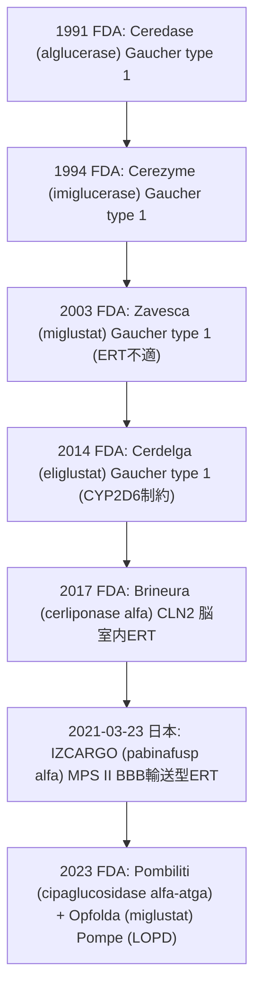

  {{ page.content_type }}
  {{ page.stage }}
  {{ c }}

## 概要

リソソームは、細胞内で不要物や高分子を分解・リサイクルするオルガネラです。リソソームには多数の加水分解酵素（lysosomal hydrolases）が存在し、これらの酵素遺伝子の変異や、リソソーム機能維持に関わるタンパク質の欠損は、基質（substrate）の蓄積を介して重篤な病態（lysosome-related disorders）を引き起こし得ます。
本記事では、リソソーム関連疾患に対する承認薬を、作用形式（ERT / SRT / 薬理シャペロン / 遺伝子治療）で整理し、表に記した地域の承認年の時系列で俯瞰できるようにまとめます。

ERT（Enzyme Replacement Therapy；酵素補充療法）は、欠損・機能低下したリソソーム酵素を外因性に補充する治療で、末梢臓器病変に対して標準治療として確立してきました。一方で、通常の酵素製剤は静脈内投与後に血液脳関門（BBB；blood–brain barrier）を通過しにくく、中枢神経症状（CNS manifestations）への作用が制限されます。pabinafusp alfaのように、受容体を利用するBBB輸送機能を酵素に組み込む設計は、この送達上の制約に対応するアプローチです。[^27][^jcr-iz-label]

そこで近年は、基質の産生側を抑えるSRT、変異酵素のフォールディング／トラフィッキングを補助する薬理シャペロン、投与経路を工夫して中枢神経系へ直接送達するアプローチ（脳室内投与など）、さらに遺伝子導入により長期的な酵素活性の回復を狙う遺伝子治療へと、治療モダリティが拡張してきました。

## 承認済みリソソーム標的薬（主要）

各行に記した地域での承認年順に並べています。**「承認年」は世界初承認年に統一したものではなく、同じ一般名でも適応・剤形・地域で承認時期が異なります。** 適応の記載は要約であり、詳細は各地域の承認文書によります。会社名は開発・販売に関わる企業を示し、承認当時の社名を含みます。

| 疾患/適応 | 一般名［販売名］ | 作用形式 | 会社 | 承認年（記載地域） | 投与 | メモ |
|---|---|---|---|---|---|---|
| Gaucher病1型・3型の非中枢神経症状（米国） | imiglucerase［Cerezyme］ | ERT | Sanofi Genzyme | 1994（米）[^1] | 点滴 | 組換えERT。3型への米国適応拡大は2026年[^cerezyme2026] |
| Cystinosis | **cysteamine**［Cystagon/Procysbi］ | **シスチン低下** | Mylan/Horizon | 1994（米：IR）[^2] | 経口 | 遅延放出（DR）は2013（米）[^3] |
| Fabry病（EU） | agalsidase alfa［Replagal］ | ERT | Takeda | 2001（EU）[^4] | 点滴 | EU承認品目として掲載 |
| Fabry病 | agalsidase beta［Fabrazyme］ | ERT | Sanofi Genzyme | 2003（米）[^5] | 点滴 | 主要ERT |
| MPS I | laronidase［Aldurazyme］ | ERT | BioMarin/Genzyme | 2003（米/EU）[^6] | 点滴 | IDUAを補充 |
| Gaucher病1型（ERT不適） | miglustat［Zavesca］ | **SRT** | Actelion→Janssen | 2003（米）[^7] | 経口 | 代替療法（EUではNPCにも適応） |
| MPS VI | galsulfase［Naglazyme］ | ERT | BioMarin | 2005（米）[^8] | 点滴 | ARSBを補充 |
| Pompe病 | alglucosidase alfa［Myozyme/Lumizyme］ | ERT | Sanofi | 2006（EU/米）[^9] | 点滴 | Myozymeの承認年を記載 |
| MPS II（ハンター） | idursulfase［Elaprase］ | ERT | Takeda | 2006（米）[^10] | 点滴 | 週1回投与 |
| NPC（Niemann–Pick C） | **miglustat**［Zavesca］ | **SRT** | Advanz等 | 2009（EU）[^11] | 経口 | 進行性神経症状にEU適応 |
| Gaucher病1型 | velaglucerase alfa［VPRIV］ | ERT | Shire→Takeda | 2010（米）[^12] | 点滴 | 別の酵素製剤 |
| Gaucher病1型 | taliglucerase alfa［Elelyso］ | ERT | Protalix/Pfizer | 2012（米）[^13] | 点滴 | 植物細胞由来 |
| Gaucher病1型 | eliglustat［Cerdelga］ | **SRT** | Sanofi Genzyme | 2014（米）[^14] | 経口 | GCS阻害。CYP2D6表現型で適格性・用量を規定 |
| MPS IVA（モルキオA） | elosulfase alfa［Vimizim］ | ERT | BioMarin | 2014（米）[^15] | 点滴 | GALNSを補充 |
| LAL欠損症 | sebelipase alfa［Kanuma］ | ERT | Alexion | 2015（米/EU）[^16] | 点滴 | LALを補充 |
| Fabry病 | **migalastat**［Galafold］ | **薬理シャペロン** | Amicus | 2016（EU）[^17] | 経口 | 変異“amenable”例に限定 |
| MPS VII（Sly） | vestronidase alfa［Mepsevii］ | ERT | Ultragenyx | 2017（米）[^18] | 点滴 | 超希少疾患 |
| CLN2（バッテン病） | cerliponase alfa［Brineura］ | **脳室内ERT** | BioMarin | 2017（米/EU）[^19] | 脳室内 | 中枢投与 |
| α-マンノシドーシス | velmanase alfa［Lamzede］ | ERT | Chiesi | 2018（EU）[^20] | 点滴 | 非中枢神経症状が対象。2023年に米国承認[^21] |
| Fabry病 | agalsidase beta biosimilar 1［アガルシダーゼ ベータBS「JCR」］ | ERT（biosimilar） | JCR Pharmaceuticals | 2018-09-21（日本）[^jcr-ag-if] | 点滴 | Fabrazymeのbiosimilar。開発コードJR-051[^jcr-ag-label] |
| 異染性白質ジストロフィー(MLD) | **atidarsagene autotemcel**［Libmeldy / Lenmeldy］ | **遺伝子治療**（自家HSC） | Orchard | 2020（EU）[^22] | 移植 | 2024年に米国でもLenmeldyとして承認[^lenmeldy] |
| MPS II（Hunter syndrome） | **pabinafusp alfa［IZCARGO／イズカーゴ］** | **BBB輸送型ERT（J-Brain Cargo）** | JCR Pharmaceuticals | **2021-03-23（日本）**[^jcr-iz-if] | 点滴 | 開発コードJR-141。抗TfR抗体–IDS融合タンパク質。週1回投与[^jcr-iz-label] |
| Pompe病（遅発型） | avalglucosidase alfa［Nexviazyme］ | ERT | Sanofi | 2021（米）[^23] | 点滴 | EUのNexviadymeは2022年承認[^nexviadyme-eu] |
| ASMD（Niemann–Pick A/B） | olipudase alfa［Xenpozyme］ | ERT | Sanofi | 2022（JP→EU/米）[^24] | 点滴 | 非中枢症状に適応 |
| Fabry病 | pegunigalsidase alfa［Elfabrio］ | ERT | Protalix/Chiesi | 2023（米/EU）[^25] | 点滴 | PEG修飾ERT |
| Pompe病（成人） | cipaglucosidase alfa＋miglustat［Pombiliti+Opfolda］ | ERT＋酵素安定化剤 | Amicus | 2023（米/EU）[^26] | 点滴＋経口 | miglustatは補充酵素を安定化 |

表中の略語：MPS＝mucopolysaccharidosis、LAL＝lysosomal acid lipase、ASMD＝acid sphingomyelinase deficiency、MLD＝metachromatic leukodystrophy、HSC＝hematopoietic stem cell、LOPD＝late-onset Pompe disease、PEG＝polyethylene glycol。IR／DRは、それぞれimmediate release／delayed releaseを示します。

[^1]: FDA Orphan Drug Designations and Approvals: Cerezyme (imiglucerase) — Marketing Approval Date 05/23/1994.  [FDA Access Data](https://www.accessdata.fda.gov/scripts/opdlisting/oopd/detailedIndex.cfm?cfgridkey=62491)
[^2]: FDA Orphan Drug Designations and Approvals: Cystagon (cysteamine) — Marketing Approval Date 08/15/1994.  [FDA Access Data](https://www.accessdata.fda.gov/scripts/opdlisting/oopd/detailedIndex.cfm?cfgridkey=55690)
[^3]: FDA. Procysbi（cysteamine bitartrate）初回承認文書、2013年4月30日。[承認文書](https://www.accessdata.fda.gov/drugsatfda_docs/nda/2013/203389Orig1s000Approv.pdf)。
[^4]: EMA EPAR: Replagal — EU marketing authorisation granted 3 Aug 2001.  [European Medicines Agency (EMA)](https://www.ema.europa.eu/en/medicines/human/EPAR/replagal)
[^5]: FDA Orphan Drug Designations and Approvals: Fabrazyme (agalsidase beta) — Marketing Approval Date 04/24/2003.  [FDA Access Data](https://www.accessdata.fda.gov/scripts/opdlisting/oopd/detailedIndex.cfm?cfgridkey=15286)
[^6]: FDA Orphan Drug Designations and Approvals: Aldurazyme (laronidase) — Marketing Approval Date 04/30/2003.  [FDA Access Data](https://www.accessdata.fda.gov/scripts/opdlisting/oopd/detailedIndex.cfm?cfgridkey=106097)
[^7]: FDA Orphan Drug Designations and Approvals: Zavesca (miglustat) — Marketing Approval Date 07/31/2003.  [FDA Access Data](https://www.accessdata.fda.gov/scripts/opdlisting/oopd/detailedIndex.cfm?cfgridkey=112598)
[^8]: FDA. Naglazyme（galsulfase）承認文書、2005年5月31日。[承認文書](https://www.accessdata.fda.gov/drugsatfda_docs/nda/2005/125117s000_Naglazyne_approv.pdf)。
[^9]: EMA. Myozyme（alglucosidase alfa）EPAR。EU承認日2006年3月29日。[EPAR](https://www.ema.europa.eu/en/medicines/human/EPAR/myozyme)。MyozymeとLumizymeの製品別承認年は同一ではない。
[^10]: FDA Purple Book. Elaprase（idursulfase）、BLA 125151。米国初回承認日2006年7月24日。[承認情報](https://purplebooksearch.fda.gov/index.cfm?blaNo=125151&event=productdetails)。
[^11]: EMA. Zavesca（miglustat）EPAR。NPCの進行性神経症状に対する適応情報。[EPAR](https://www.ema.europa.eu/en/medicines/human/EPAR/zavesca)。NPCへの適応追加は2009年（Gaucher病に対するEU初回承認は2002年）。
[^12]: Shire. FDA approval of VPRIV（velaglucerase alfa）, 2010年2月26日。[企業公表資料（SEC提出書類）](https://www.sec.gov/Archives/edgar/data/936402/000095010310000594/dp16692_ex9901.htm)。
[^13]: FDA. Elelyso（taliglucerase alfa）承認書、2012年5月1日。[承認書](https://www.accessdata.fda.gov/drugsatfda_docs/appletter/2012/022458s000ltr.pdf)。
[^14]: FDA Orphan Drug Designations and Approvals: Cerdelga (eliglustat) — Marketing Approval Date (FDA OPD listing).  [FDA Access Data](https://www.accessdata.fda.gov/scripts/opdlisting/oopd/detailedIndex.cfm?cfgridkey=265408)
[^15]: FDA. Vimizim（elosulfase alfa）Orphan Drug Designations and Approvals。承認日2014年2月14日。[承認情報](https://www.accessdata.fda.gov/scripts/opdlisting/oopd/detailedIndex.cfm?cfgridkey=280809)。
[^16]: EMA. Kanuma（sebelipase alfa）EPAR。[EU承認情報](https://www.ema.europa.eu/en/medicines/human/EPAR/kanuma)。FDA. 2015年12月8日承認書。[米国承認書](https://www.accessdata.fda.gov/drugsatfda_docs/appletter/2015/125561Orig1s000ltr.pdf)。
[^17]: EMA. Galafold（migalastat）EPAR。EU承認日2016年5月25日。[EPAR](https://www.ema.europa.eu/en/medicines/human/EPAR/galafold)。
[^18]: Ultragenyx press release: FDA approval of Mepsevii (vestronidase alfa) on Nov 15, 2017.  [Ultragenyx](https://ir.ultragenyx.com/news-releases/news-release-details/ultragenyx-announces-fda-approval-mepseviitm-vestronidase-alfa)
[^19]: FDA approval document for Brineura (cerliponase alfa), dated Apr 27, 2017.  [FDA Access Data](https://www.accessdata.fda.gov/drugsatfda_docs/nda/2017/761052Orig1s000Approv.pdf)
[^20]: EMA. Lamzede（velmanase alfa）EPAR。EU承認日2018年3月23日。[EPAR](https://www.ema.europa.eu/en/medicines/human/EPAR/lamzede)。
[^21]: FDA Orphan Drug Designations and Approvals: Lamzede (velmanase alfa) — US marketing approval (FDA OPD listing).  [FDA Access Data](https://www.accessdata.fda.gov/scripts/opdlisting/oopd/detailedIndex.cfm?cfgridkey=212005)
[^22]: EMA EPAR: Libmeldy — EU marketing authorisation valid throughout EU on 17 Dec 2020.  [European Medicines Agency (EMA)](https://www.ema.europa.eu/en/medicines/human/EPAR/libmeldy)
[^23]: FDA Purple Book. Nexviazyme（avalglucosidase alfa-ngpt）、BLA 761194。米国初回承認日2021年8月6日。[承認情報](https://purplebooksearch.fda.gov/index.cfm?blaNo=761194&event=productdetails)。
[^24]: FDA Orphan Drug Designations and Approvals: Xenpozyme (olipudase alfa-rpcp) — Marketing Approval Date 08/31/2022; Japan first approval mentioned by Sanofi (Mar 2022).  [FDA Access Data](https://www.accessdata.fda.gov/scripts/opdlisting/oopd/detailedIndex.cfm?cfgridkey=132900)
[^25]: FDA approval letter: Elfabrio (pegunigalsidase alfa-iwxj) — approved effective May 9, 2023.  [FDA Access Data](https://www.accessdata.fda.gov/drugsatfda_docs/appletter/2023/761161Orig1s000ltr.pdf)
[^26]: EMA. Pombiliti（cipaglucosidase alfa）EPAR、2023年3月20日承認。[EPAR](https://www.ema.europa.eu/en/medicines/human/EPAR/pombiliti)。米国でのPombiliti＋Opfoldaの併用適応は2023年承認。[FDA Pombilitiラベル](https://www.accessdata.fda.gov/drugsatfda_docs/label/2023/761204s000lbl.pdf)、[FDA Opfoldaラベル](https://www.accessdata.fda.gov/drugsatfda_docs/label/2023/215211s000lbl.pdf)。

## 対象疾患について

上記のリソソーム標的薬の対象疾患は、リソソームの機能破綻を背景にします。内訳としては、リソソーム加水分解酵素（lysosomal hydrolase）の欠損に起因するLysosomal Storage Diseases（LSD）が中心ですが、酵素欠損ではない疾患も一部含まれます。

### リソソーム加水分解酵素欠損による典型的なLSD（Lysosomal Storage Diseases）

- Gaucher病（GBA1 / β-glucocerebrosidase）
- Fabry病（GLA / α-galactosidase A）
- Pompe病（GAA / acid α-glucosidase）
- MPS I/II/IVA/VI/VII（IDUA / IDS / GALNS / ARSB / GUSB）
- LAL欠損症（LAL-D）（LIPA / lysosomal acid lipase）
- CLN2（TPP1 / tripeptidyl peptidase 1）
- ASMD（Niemann–Pick A/B）（SMPD1 / acid sphingomyelinase）
- α-マンノシドーシス（MAN2B1 / lysosomal α-mannosidase）
- MLD（ARSA / arylsulfatase A）

### （表内の例外）加水分解酵素欠損ではない lysosome-related disorders

- NPC（Niemann–Pick C）：主にNPC1/NPC2（脂質輸送・トラフィッキング異常）

- Cystinosis：CTNS（cystinosin：リソソーム膜輸送体）欠損

## モダリティ（治療アプローチ）

本記事で扱う「リソソーム標的薬」は、主に <strong>(i) 欠損酵素を補う</strong>、<strong>(ii) 蓄積基質の産生を抑える</strong>、<strong>(iii) 変異酵素のフォールディング/輸送を助ける</strong>、<strong>(iv) 遺伝子を導入して持続的に酵素活性を回復する</strong>、の4系統に整理できます。

### ERT（Enzyme Replacement Therapy；酵素補充療法）

定義：欠損または機能低下したリソソーム加水分解酵素を、<strong>組換えタンパク質（recombinant enzyme）として外因性に補充</strong>する治療です。多くは <strong>静脈内投与（IV infusion）を反復</strong>して行います。[^27]

<strong>細胞内取り込みとリソソーム送達</strong>：ERT製剤は、末梢組織で <strong>受容体介在性エンドサイトーシス（receptor-mediated endocytosis）</strong>により細胞内へ取り込まれ、エンドソーム—リソソーム経路で標的区画へ送達されます。一般に <strong>mannose-6-phosphate receptor（M6PR）経路</strong>が基盤概念として重要であり、糖鎖を介した受容体結合が細胞内取り込みに関わります。[^28] 一方、<strong>Gaucher病のβ-glucocerebrosidase（imiglucerase など）では、標的細胞であるマクロファージのendocytic carbohydrate receptor（mannose receptor）に認識される “mannose-terminated” 糖鎖が実装上の設計勘所</strong>として明示されています。[^29]

<strong>限界</strong>  

- <strong>BBB（blood–brain barrier；血液脳関門）/CNS（central nervous system；中枢神経）移行の制約</strong>：
  通常の酵素製剤による全身投与ERTはBBBを通過しにくく、<strong>中枢症状（CNS manifestations）には効果が限定的</strong>になりやすい。[^27]  

- <strong>免疫原性と投与負担</strong>：
  定期的な点滴投与に伴う <strong>注入反応(infusion-associated reactions)</strong>、過敏反応、抗薬物抗体（anti-drug antibodies）などが課題です。[^30][^jcr-iz-label]

<strong>例外</strong>：<strong>Brineura（cerliponase alfa）</strong>は、CLN2（TPP1欠損）に対して <strong>脳室内投与（intraventricular infusion）</strong>を採用し、CNSへ直接投与する設計がラベルに示されています。[^30]

#### BBB輸送型ERT：pabinafusp alfa / IZCARGO（JR-141）

<strong>承認上の位置付け</strong>：pabinafusp alfaは、ヒト化抗ヒトtransferrin receptor 1（TfR）抗体とhuman iduronate-2-sulfatase（IDS）を融合した組換えタンパク質です。日本では2021年3月23日にMPS IIを効能・効果として承認され、同年5月19日に発売されました。電子添文には、中枢神経症状の改善または進行抑制が必要と考えられる患者で投与を検討する旨が記されています。[^jcr-iz-label][^jcr-iz-if]

<strong>分子設計と非臨床での検証</strong>：J-Brain Cargoは、TfRを利用するBBB輸送技術です。2018年の原著では、human TfR knock-in mice、MPS II model mice、monkeysで融合タンパク質の脳内分布を調べ、疾患モデルマウスでは脳内glycosaminoglycans（GAG）の減少を報告しました。これは非臨床のproof of conceptにあたり、ヒトでの神経認知機能への効果は臨床データから別途評価する必要があります。[^jcr-sonoda2018]

<strong>BBB通過からリソソームまで</strong>：電子添文の作用機序には、以下の過程が示されています。[^jcr-iz-label]

1. 抗体部分が脳毛細血管内皮のTfRに結合し、<strong>receptor-mediated transcytosis（受容体介在性トランスサイトーシス）</strong>を介してBBBを通過する。
2. 末梢組織および脳実質の細胞では、<strong>cation-independent mannose-6-phosphate receptor（CI-M6PR）およびTfR</strong>を介して取り込まれ、リソソームへ運ばれる。
3. 薬剤の酵素部分（IDS）が酵素として作用し、蓄積したGAGの分解に関わる。

この設計では、BBB内皮を越える輸送と、標的細胞内でのリソソーム送達の両方を考える必要があります。[^jcr-iz-label][^jcr-sonoda2018]

<strong>国内第II/III相試験で示されたこと</strong>：Okuyamaらの試験は、MPS IIの28例を対象とした<strong>単群・非盲検の52週間試験</strong>でした。25例はidursulfaseの既治療例です。主要評価項目はcerebrospinal fluid（CSF；脳脊髄液）中heparan sulfate（HS）濃度で、解析対象27例の平均値（±標準偏差）は、投与開始前の<strong>5,856 ± 2,614 ng/mLから52週時点の2,124 ± 882.6 ng/mL</strong>へ低下しました。[^jcr-okuyama2021]

<strong>神経発達への効果の限界</strong>：

- 脳脊髄液（CSF）中heparan sulfate（HS）の低下は薬力学的変化を支持しますが、PMDAは、HSの変化と発達年齢の変化との間に明確な関係が示されていないと評価しました。承認時点のデータから、中枢神経症状の明確な改善を確認するには限界がありました。[^jcr-iz-review]
- 論文ではKyoto Scale of Psychological Development（KSPD；新版K式発達検査）による維持・改善が報告されました。ただし、同時対照群がなく、年齢、病型、開始時の発達段階、自然経過のplateauが解釈に影響します。著者らも、52週間では神経発達への確定的な結論を得るには短いとしています。[^jcr-okuyama2021]
- PMDAは希少性や長期評価の必要性も踏まえて一定の有効性を期待できると判断し、全投与症例を対象とした製造販売後臨床試験または使用成績調査、定期的な成績提出などを承認条件としました。[^jcr-iz-review][^jcr-mhlw2026]

<strong>安全性と長期データ</strong>：国内試験ではinfusion-associated reactions（点滴に伴う反応）と抗薬物抗体の産生が報告され、電子添文では重度の点滴関連反応やanaphylaxis（アナフィラキシー）への注意が示されています。2026年公表の27例・260週間のデータを用いた事後解析では、点滴時間の短縮と有害事象増加との関連は認められず、HS等の生化学的指標や肝脾容積にも点滴速度変更の影響は認められませんでした。[^jcr-okuyama2021][^jcr-iz-label][^jcr-nakamura2026]

<strong>海外開発・承認との区別</strong>：2026年10月2日の企業発表では、idursulfaseを実薬対照とする国際第III相<strong>STARLIGHT（JR-141-GS31、NCT04573023）</strong>が継続中で、欧米等での承認取得を目指すとされています。試験は無作為化・評価者盲検であり、非対照の国内承認時試験とは設計が異なります。日本での承認に加え、企業は2026年7月のUAE承認、同年10月のKuwaitでの条件付き承認を公表しています。[^jcr-starlight][^jcr-license2026][^jcr-kuwait2026]

---

### SRT（Substrate Reduction Therapy；基質生成抑制療法）

定義：分解できずに蓄積する基質（substrate）の <strong>産生側</strong>を抑えることで、リソソームへの負荷を低下させる治療です。<strong>経口投与（oral）</strong>の選択肢になり得ます。[^31]

<strong>Gaucher病での代表例（本記事の表に掲載）</strong>  

- <strong>miglustat（Zavesca）</strong>：
  成人の Gaucher病 type 1 において、<strong>ERTが治療選択肢にならない</strong>患者を対象に <strong>単剤（monotherapy）</strong>として適応が規定されています。[^31]  

- <strong>eliglustat（Cerdelga）</strong>：
  <strong>glucosylceramide synthase（GCS）阻害</strong>によるSRTです。適格性・投与設計に<strong>CYP2D6表現型</strong>が組み込まれています。米国ラベルではextensive、intermediate、poor metabolizersが適応に含まれる一方、ultra-rapid metabolizersでは十分な薬物濃度が得られない可能性があり、代謝型を判定できないindeterminate metabolizersでは特定の用量を推奨できないとされています。[^32][^33]

---

### 薬理シャペロン（Pharmacological chaperone）

定義：特定の変異で不安定化/ミスフォールディングしたリソソーム酵素に結合し、<strong>立体構造の安定化（stabilization）とリソソームへのトラフィッキング回復</strong>を介して残存活性を引き出すアプローチです。

<strong>例：Fabry病</strong>：<strong>migalastat（Galafold）</strong>は、<strong>in vitro試験で感受性が確認されたGLA遺伝子変異（amenable variant）を有する患者に限定して、適応が認められています。</strong>[^34][^35]

---

### 遺伝子治療（Gene therapy）

定義：標的タンパク質（多くは欠損酵素）の遺伝子を導入し、<strong>酵素の持続的な産生</strong>を狙った治療です。

<strong>例：異染性白質ジストロフィー(MLD)</strong>：<strong>atidarsagene autotemcel（Libmeldy）</strong>は、自家造血幹細胞（autologous CD34+ HSC）に対し ex vivo で遺伝子導入を行う細胞遺伝子治療薬として、EUでLibmeldy、米国でLenmeldyとして承認されています（対象となる発症型・病期は承認文書に規定）。本治療においては、発症・進行前の適切な投与タイミングの設定と、長期的な経過観察が必要です。[^36][^37][^lenmeldy]

---

## モダリティ開発のマイルストーン

1. <strong>1991：Ceredase（alglucerase）</strong> — Gaucher病 type 1 で <strong>placenta由来</strong>の初期ERTがFDAで承認（のちにrecombinantへ置換）。[^38]  
2. <strong>1994：Cerezyme（imiglucerase）</strong> — Gaucher病 type 1 で <strong>recombinant ERT</strong>がFDAで初回承認（以後の標準ERTの基盤）。[^39][^29]  
3. <strong>2003：Zavesca（miglustat）</strong> — Gaucher病 type 1 に <strong>経口SRT</strong>が臨床導入（ERT不適例を想定）。[^31]  
4. <strong>2014：Cerdelga（eliglustat）</strong> — <strong>CYP2D6表現型に基づく適格性/投与設計</strong>を伴うSRTがFDAで承認。[^32]  
5. <strong>2017：Brineura（cerliponase alfa）</strong> — <strong>脳室内ERT</strong>としてCNSへ直接投与する設計がFDAで承認。[^30]  
6. <strong>2021-03-23：IZCARGO（pabinafusp alfa）</strong> — TfRを介したBBB輸送機能を組み込んだERTとして、日本でMPS IIに承認。[^jcr-iz-label][^jcr-iz-if]
7. <strong>2023：Pombiliti（cipaglucosidase alfa-atga）＋ Opfolda（miglustat）</strong> — Pompe病（LOPD）で<strong>ERT＋補充酵素の安定化剤</strong>の併用がFDAで承認。[^40][^41]

[^27]: PMDA. 「イズカーゴ点滴静注用10mg」審査報告書、2021年。既存の静脈内ERTのBBB移行上の課題とJR-141の評価。[審査報告書](https://www.pmda.go.jp/drugs/2021/P20210402002/530210000_30300AMX00260_A100_1.pdf)。
[^28]: FDA. Myozyme（alglucosidase alfa）label、2014年、12.1 Mechanism of Action。M6P receptorを介した取り込みとリソソームへの輸送。[ラベル](https://www.accessdata.fda.gov/drugsatfda_docs/label/2014/125141s219lbl.pdf)。
[^29]: FDA. Cerezyme (imiglucerase) label（mannose-terminated糖鎖がmacrophageのendocytic carbohydrate receptorに認識される旨）. [FDA Access Data](https://www.accessdata.fda.gov/drugsatfda_docs/label/2002/20367s53lbl.pdf)
[^30]: FDA. Brineura (cerliponase alfa) label（intraventricular route 等）. [FDA Access Data](https://www.accessdata.fda.gov/drugsatfda_docs/label/2017/761052lbl.pdf)
[^31]: FDA. Zavesca (miglustat) label（GD1でERT不適例のmonotherapy等）. [FDA Access Data](https://www.accessdata.fda.gov/drugsatfda_docs/label/2020/021348s016lbl.pdf)
[^32]: FDA. Drug Approval Package: Cerdelga (eliglustat) – Approval Date 8/19/2014. [FDA Access Data](https://www.accessdata.fda.gov/drugsatfda_docs/nda/2014/205494Orig1s000TOC.cfm)
[^33]: FDA. Cerdelga（eliglustat）label、2014年。中間代謝型（intermediate）と判定不能（indeterminate）は異なり、中間代謝型も適応に含まれる。 [FDA Access Data](https://www.accessdata.fda.gov/drugsatfda_docs/label/2014/205494orig1s000lbl.pdf)
[^34]: FDA. Galafold (migalastat) label（amenable GLA variant を適応条件として明示）. [FDA Access Data](https://www.accessdata.fda.gov/drugsatfda_docs/label/2024/208623s008lbl.pdf)
[^35]: EMA. Galafold EPAR（EUでの承認とamenable mutationについての概説）. [European Medicines Agency](https://www.ema.europa.eu/en/medicines/human/EPAR/galafold)
[^36]: EMA. Libmeldy EPAR（EUでのマーケティングオーソリゼーション日：17 Dec 2020）. [European Medicines Agency](https://www.ema.europa.eu/en/medicines/human/EPAR/libmeldy)
[^37]: EMA. Libmeldy EPAR product information（治療内容：autologous CD34+ HSC, ex vivo gene transfer 等）. [European Medicines Agency](https://www.ema.europa.eu/en/documents/product-information/libmeldy-epar-product-information_en.pdf)
[^38]: FDA Orphan Drug Designations and Approvals: Ceredase (alglucerase) — Marketing Approval Date 04/05/1991. [FDA Access Data](https://www.accessdata.fda.gov/scripts/opdlisting/oopd/detailedIndex.cfm?cfgridkey=5585)
[^39]: FDA Purple Book: CEREZYME (imiglucerase) BLA 020367 — Original Approval Date May 23, 1994. [FDA Purple Book](https://purplebooksearch.fda.gov/productdetails?query=020367)
[^40]: FDA. Pombiliti (cipaglucosidase alfa-atga) label（Initial U.S. Approval: 2023）. [FDA Access Data](https://www.accessdata.fda.gov/drugsatfda_docs/label/2023/761204s000lbl.pdf)
[^41]: FDA. Opfolda（miglustat）label、2023年。Pombilitiと併用するenzyme stabilizerとしての適応。[ラベル](https://www.accessdata.fda.gov/drugsatfda_docs/label/2023/215211s000lbl.pdf)。ラベル上の「Initial U.S. Approval: 2003」はmiglustat自体の承認歴であり、Pompe病に対する本併用療法の承認年とは区別する。

## 出典

承認情報は規制当局資料、臨床所見は治験原著論文、開発段階は日付のある企業IRと試験登録に基づきます。企業公表と査読論文、バイオマーカー変化と機能評価、治験の開始と承認を区別しています。

[^jcr-iz-label]: PMDA. 「イズカーゴ点滴静注用10mg」電子添文、2024年7月改訂（第3版）。効能・効果、効能関連注意、重大な副作用、17.1 臨床成績、18.1 作用機序。[電子添文](https://www.pmda.go.jp/PmdaSearch/iyakuDetail/530210_3959424D1023_1_03)（2026年11月8日確認）。
[^jcr-iz-if]: JCR Pharmaceuticals. 「イズカーゴ点滴静注用10mg」医薬品インタビューフォーム、2024年9月改訂（第7版）。国内承認日2021年3月23日、発売日同年5月19日。[インタビューフォーム](https://www.jcrpharm.co.jp/assets/uploads/docs/medical_products_IF-IZ-007A.pdf)。
[^jcr-iz-review]: PMDA. 「イズカーゴ点滴静注用10mg」審査報告書、2021年。特に7.R.1.1の有効性評価、審査報告（2）および承認条件。[日本語原本](https://www.pmda.go.jp/drugs/2021/P20210402002/530210000_30300AMX00260_A100_1.pdf)、[参考英訳](https://www.pmda.go.jp/files/000242410.pdf)。
[^jcr-sonoda2018]: Sonoda H, et al. A Blood-Brain-Barrier-Penetrating Anti-human Transferrin Receptor Antibody Fusion Protein for Neuronopathic Mucopolysaccharidosis II. *Molecular Therapy*. 2018;26:1366–1374. オンライン公表2018年3月6日。[doi:10.1016/j.ymthe.2018.02.032](https://doi.org/10.1016/j.ymthe.2018.02.032)、[原著全文](https://pmc.ncbi.nlm.nih.gov/articles/PMC5993955/)。
[^jcr-okuyama2021]: Okuyama T, et al. A Phase 2/3 Trial of Pabinafusp Alfa, IDS Fused with Anti-Human Transferrin Receptor Antibody, Targeting Neurodegeneration in MPS-II. *Molecular Therapy*. 2021;29:671–679. [doi:10.1016/j.ymthe.2020.09.039](https://doi.org/10.1016/j.ymthe.2020.09.039)、[原著全文](https://pmc.ncbi.nlm.nih.gov/articles/PMC7854283/)。CSF中HSは27例の解析集団・欠測補完による集計。
[^jcr-nakamura2026]: Nakamura K, et al. Infusion rate adjustment in enzyme replacement therapy with pabinafusp alfa for mucopolysaccharidosis II. *British Journal of Clinical Pharmacology*. 2026;92:3140–3150. オンライン公表2026年5月17日。[doi:10.1002/bcp.70612](https://doi.org/10.1002/bcp.70612)、[PubMed](https://pubmed.ncbi.nlm.nih.gov/42144501/)。
[^jcr-mhlw2026]: 厚生労働省. 医薬品等行政評価・監視委員会資料、2026年6月16日。イズカーゴの国内承認日・発売日、および制度上の条件付き承認該当性の整理。[資料](https://www.mhlw.go.jp/content/10601000/001711926.pdf)。
[^jcr-ag-label]: PMDA. 「アガルシダーゼ ベータBS点滴静注5mg『JCR』／同35mg『JCR』」電子添文、2022年10月改訂。効能関連注意、18.1 作用機序等。[電子添文](https://www.pmda.go.jp/PmdaSearch/iyakuDetail/530210_3959420A1029_1_04)（2026年11月8日確認）。
[^jcr-ag-if]: JCR Pharmaceuticals. 「アガルシダーゼ ベータBS点滴静注『JCR』」医薬品インタビューフォーム、2023年1月改訂（第5版）。開発コードJR-051、国内承認日2018年9月21日。[インタビューフォーム](https://www.jcrpharm.co.jp/assets/uploads/docs/medical_products_IF-AG-005A.pdf)。[PMDA・2018年度承認品目一覧](https://www.pmda.go.jp/files/000233675.pdf)でも承認日を確認。
[^jcr-starlight]: ClinicalTrials.gov. STARLIGHT、JR-141-GS31、[NCT04573023](https://clinicaltrials.gov/study/NCT04573023)。試験設計は[EU公式試験登録・EudraCT 2020-003200-14](https://www.clinicaltrialsregister.eu/ctr-search/trial/2020-003200-14/FR)および[UCSF参加施設情報](https://clinicaltrials.ucsf.edu/trial/NCT04573023)も参照。旧EU登録は改訂前の予定症例数を含む。
[^jcr-license2026]: JCR Pharmaceuticals. 「ハンター症候群の新規治療剤JR-141 欧米等における商業化に関するライセンス契約締結のお知らせ」、2026年10月2日。[企業発表](https://www.jcrpharm.co.jp/news/002508.html)。
[^jcr-kuwait2026]: JCR Pharmaceuticals. 「血液脳関門通過型ハンター症候群治療酵素製剤『イズカーゴ』クウェート国での製造販売承認取得のお知らせ」、2026年10月14日。UAEでの2026年7月承認にも言及。[企業発表](https://www.jcrpharm.co.jp/news/002512.html)。
[^jcr-ir20261029]: JCR Pharmaceuticals. 「2027年3月期 第2四半期（中間期）決算短信」、2026年10月29日。添付資料3頁「ライソゾーム病治療薬」にJR-171の第I/II相・継続試験完了を記載。添付資料12頁に各候補のパイプラインを掲載。[決算短信](https://www.jcrpharm.co.jp/assets/uploads/docs/FY2026-Q2_Financial_Report_JP.pdf)。
[^jcr-briefing20261029]: JCR Pharmaceuticals. 「2027年3月期 第2四半期 決算説明会資料」、2026年10月29日。JR-441／JR-446の国内開発方針およびJR-471関連自然歴研究。[説明会資料](https://www.jcrpharm.co.jp/assets/uploads/docs/FY2026-Q2_Results_Briefing_Session_JP.pdf)。自然歴研究：[NCT07615400](https://clinicaltrials.gov/study/NCT07615400)。
[^jcr-jr441]: EMA. posnafusp alfaの[orphan designation（EU/3/21/2560）](https://www.ema.europa.eu/en/medicines/human/orphan-designations/eu-3-21-2560)。試験登録：[NCT06095388](https://clinicaltrials.gov/study/NCT06095388)、[EU公式旧登録・EudraCT 2022-002314-17](https://www.clinicaltrialsregister.eu/ctr-search/trial/2022-002314-17/DE)、国内[jRCT2071240053](https://jrct.mhlw.go.jp/latest-detail/jRCT2071240053)（国内第I相）。Orphan designationは製造販売承認ではない。
[^jcr-jr446]: JCR Pharmaceuticals. JR-446グローバル第I/II相試験の初回投与に関する発表、2026年9月11日。[企業発表](https://www.jcrpharm.co.jp/news/002496.html)。国内登録：[jRCT2071240043](https://jrct.mhlw.go.jp/latest-detail/jRCT2071240043)（国内第I/II相）／[NCT06488924](https://clinicaltrials.gov/study/NCT06488924)。グローバル登録：[NCT07640984](https://clinicaltrials.gov/study/NCT07640984)。
[^jcr-jr479]: JCR Pharmaceuticals. JR-479に関するMEDIPAL HOLDINGSとの海外実施許諾および国内共同開発・商業化契約、2025年8月29日。[企業発表](https://www.jcrpharm.co.jp/assets/uploads/docs/ffe154486444d1cb880ffaadff12c12903826a18.pdf)。前臨床段階は2026年10月29日決算短信のパイプラインを参照。
[^jcr-next-platform]: JCR Pharmaceuticals. 中期経営計画「Reach Beyond, Together」、基盤技術研究の方針。[中期経営計画](https://www.jcrpharm.co.jp/ir/management/plan/)（2026年11月8日確認）。
[^jcr-just-aav]: JCR Pharmaceuticals. [JUST-AAV技術説明](https://www.jcrpharm.co.jp/innovation/just-aav/)、[Alexionとの技術ライセンスに関する発表](https://www.jcrpharm.co.jp/news/001078.html)（2025年7月8日）。
[^lenmeldy]: FDA. Lenmeldy（atidarsagene autotemcel）製品・承認情報。米国初回承認日2024年3月18日。[FDA製品ページ](https://www.fda.gov/vaccines-blood-biologics/cellular-gene-therapy-products/lenmeldy)。
[^nexviadyme-eu]: EMA. Nexviadyme（avalglucosidase alfa）EPAR。EU承認は2022年。[EPAR](https://www.ema.europa.eu/en/medicines/human/EPAR/nexviadyme)。
[^cerezyme2026]: FDA. Cerezyme（imiglucerase）label、2026年1月改訂。米国での適応はGaucher病1型または3型の非中枢神経症状。[ラベル](https://www.accessdata.fda.gov/drugsatfda_docs/label/2026/020367s123lbl.pdf)。
